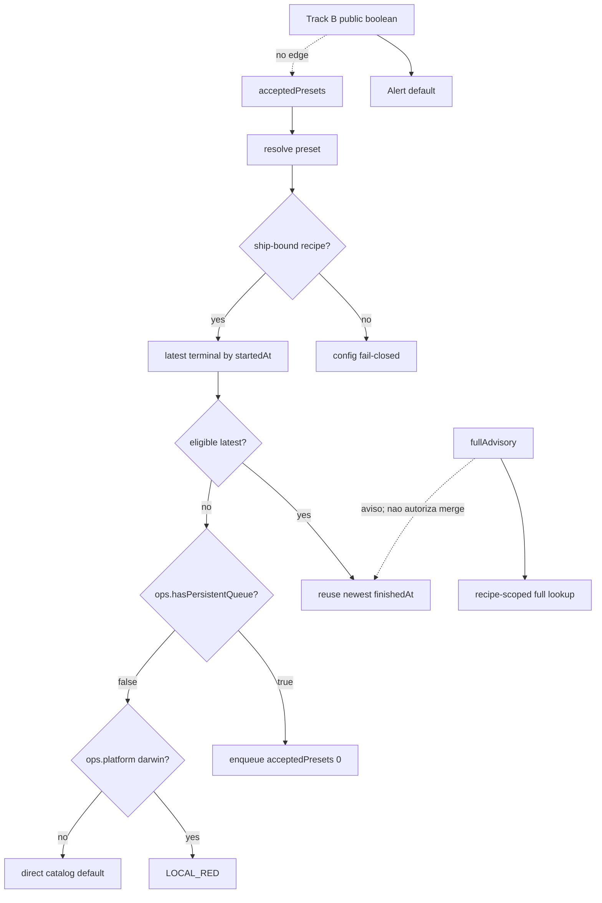

# SPEC: Prova local com progress visível e ship sem Actions

## Inputs

- PRD: `PRD.md` (Recode 11; operador autorizou Build 2026-09-18)
- Analyses consumed: `analysis.md` (Recode 11 é o decreto). Pasta `research/` é arquivo bruto, não fonte.
- Route: `analyst_prd` → Build nesta fase
- Phase budget: `deep`
- Mindset: `feature-mindset-contract.md`
- Code roots: CI Queue `/Users/marcoantonio/ci-queue`; DietFlow **somente** `/Users/marcoantonio/dietflow-ci-queue-node-pin`. Nunca `~/dietflow-app`.

## Synthesis

O operador precisa ver o teste nascer na fila instalada e deixar o `ship` mergear sem GitHub Actions. O collector, o drawer e os dois controllers de merge **já existem**; o que fura o pacote no DietFlow é uma segunda definição de prova (`findLocalProofTicket` + `ProofPreset` hardcoded, predicado sem argv/flags, verde antigo que sobrevive a falha posterior, `ci:smoketest` direto no Mac). Esta spec **elimina** essa assimetria: `ci-queue.json#ship.acceptedPresets` vira a única membership; o controlador DietFlow resolve argv+flags dali e valida a execução concreta; latest-attempt por receita; enqueue default = `[0]` (`smoketest`); macOS sem fila = `LOCAL_RED`. Progresso contínuo é outra trilha: o JobRecord público passa a dizer se a receita declarou progresso; o drawer reusa `Alert` padrão (não `destructive`) com copy invariante; 21 presets ativos ganham flag/emissor; o ratchet deixa de proibir o 13º flag. Não há aresta B→A: progress nunca autoriza nem recusa merge. O Vite observado (job + estágios ou aviso) é evidência do Plan, não assert da suíte.

## Architecture Decision

Implementar o Recode 11 **como está**. SPEC não escolhe outra arquitetura.

```text
A. INTEGRIDADE DO SHIP (DietFlow)      B. OBSERVABILIDADE
acceptedPresets fonte única            progressEnabled público
recipe argv + flags                    Alert existente (mode)
predicado material sem projectId       ratchet positivo + 21 presets
latest canonical attempt               sem aresta para A
Mac fail-closed / cloud contrato atual
```

Trilha C (cerca) permanece: sem cutover para `ci-queue ship`, sem copiar `src/ship/*`, sem controller compartilhado, sem reescrever `scripts/ship/ship.ts` inteiro, sem unificar `remote-verdict.json`, sem `projectId` no predicado DietFlow, sem attestation `local/full`, sem pin/sandbox, sem collector novo.

CI Queue produto: **não** muda `evaluateForRecipe`. Muda só a projeção pública + o chrome do aviso. Elegibilidade do `check` já é identidade material.

Dois relógios, não um. **Tentativa** (por receita): `startedAt` (fallback `createdAt`), desempate `id` — o mesmo critério de `compareLatestStarted` em `src/ship/eligibility.ts:158-164`. DietFlow reproduz o critério, não o módulo. **Seleção** (entre latest-attempts elegíveis das receitas aceitas): `finishedAt` mais novo. Isso fecha Recode 11 (“não é a primeira da lista do produto”). Não usar `finishedAt` para decidir qual tentativa é a mais nova da mesma receita: um full lento que termina depois de um retry falho sombrearia o retry.

Quem decide merge é o **ship**, não um teste. Membership = `acceptedPresets`. Qualquer latest-attempt elegível dessas receitas pode ser o ticket que o ship **reusa** para merge. Enqueue default se não houver nenhum = `[0]` (`smoketest`).

O aviso de Full é **outra pergunta**, no mesmo `runShip`: os paths do PR recomendam Full? Já existe latest elegível da receita `full`? Se sim, o aviso fica `satisfied`; se não, `pending`. O log atual já diz que isso é informativo e o piso de merge continua sendo o pacote (`ship.ts:750-756`). Smoke **não** pinta o aviso de satisfeito. O aviso **não** autoriza nem recusa merge.

Recode 11 substitui `findLocalProofTicket` (membership + latest + qual ticket o ship reusa). Não fundir esse lookup com o do aviso.



## Existing System Read

| Path | Lines | Fact |
| --- | ---: | --- |
| DietFlow `scripts/ci/queue-ticket-contract.ts` | 94-111, 153-154, 260-283 | `TicketFlags` tipado **sem** `progressEnabled`; ticket tem `argv?` e `flags?`; `ProofPreset = 'smoketest' \| 'full'`; `isQueueMaterialProofEligible` = preset + queue + passed + cwd + git; sem argv, sem flags, sem latest-attempt |
| DietFlow `scripts/ci/run.ts` | 57, 125-126 | Runtime **persiste** `progressEnabled` nas flags; `extraArgs` altera `argv` com `--` |
| DietFlow `scripts/ci/queue-client.ts` | 42 | Cliente já conhece `progressEnabled` fora do tipo `TicketFlags` |
| `src/core/enqueue.ts` | 72-79 | Produto persiste `progressEnabled` em `ticket.flags` a partir de `preset.progress` |
| `src/contracts/schema.ts` | 34-35 | `TicketFlags.progressEnabled` no schema do produto |
| DietFlow `scripts/ship/ship.ts` | 314-337, 750-756 | `findEligibleTicket` filtra só elegíveis e ordena `finishedAt`; `findLocalProofTicket` = full **depois** smoke **por nome**; `runShip` pede `findEligibleTicket(..., 'full')` **só** para advisory |
| DietFlow `scripts/ci/__tests__/jest-scope.test.ts` | 610-612 | Caller sem segundo argumento: `isQueueMaterialProofEligible(passedReviewTicket())` hoje é false via default `?? 'smoketest'` |
| DietFlow `scripts/ship/ship.ts` | 363-389 | Sem ticket: `!hasPersistentQueue()` → `npm run ci:smoketest` direto → `null`; com fila → enqueue `smoketest --wait` |
| DietFlow `scripts/ship/ship.ts` | 1007-1008 | `hasPersistentQueue` = `darwin && externalQueueAvailable(cwd)` |
| DietFlow `scripts/ci/queue-operator.ts` | 49-55 | `externalQueueAvailable` = CLI `version` não throw |
| DietFlow `ci-queue.json` | 342-345 | `acceptedPresets: ["smoketest"]`; `attestationContext: "local/smoketest"` |
| DietFlow `scripts/ci/__tests__/progress-instrumentation.test.ts` | 147-152 | `stillSilent === []` quebra o 13º `progress: true` |
| DietFlow `scripts/ci/run.ts` | 125-126 | `extraArgs` vira `argv` com `--`; custom não é receita canônica |
| `src/ship/eligibility.ts` | 116-155, 168-215 | Produto: `projectId`+argv+flags+latest por receita (startedAt); **não copiar** para o DietFlow |
| `src/ship/system-ops.ts` | 239-247 | `recipeFlags` omite `progressEnabled` e `abortOnStaleBase` |
| `src/contracts/config.ts` | 100-106 | Produto: `acceptedPreset` sem `requireCleanTree === true` + `requireGitStability === true` + `pinHeadSha === true` + `fetchBase` não vazio **não parseia**. DietFlow **não** importa este parser; reproduz a invariável no resolver |
| DietFlow `scripts/ship/ship.ts` | 98-127, 1007-1008 | `ShipOps` injetável; `hasPersistentQueue` = `darwin && CLI`; **não** expõe `platform()` hoje — `false` mistura Mac sem fila e Linux/cloud |
| `backend/ci_queue_api/records.py` | 23-27, 234-241 | `PUBLIC_JOB_FIELDS` copia só top-level; `public_job` não deriva `flags.progressEnabled` |
| `ui/src/lib/types.ts` | 48-72 | `JobRecord` sem booleano de progress configurado |
| `ui/src/features/shared/job-drawer.tsx` | 149-163 | `Alert variant="destructive"` só para `failureReason`; empty “Progresso não registrado” quando `nodes` vazio |
| `ui/src/components/ui/alert.tsx` | 10-17 | Variante `default` existe (não destrutiva) |
| `.context/domains/manifest.yaml` | 10-17 | Status/drawer canônicos |
| `docs/ui/COMPOSITION-LEDGER.md` | job detail | Drawer Dashboard 01; empty = `Empty` |
| Enqueue `check` 2026-09-18 no state instalado | — | UNPROVEN (zero `preset=check` nesse dia) |

## Files / Boundaries

| Path/Area | Action | Reason | Risk |
| --- | --- | --- | --- |
| DietFlow `ci-queue.json` `#ship` | mode | Membership `["smoketest","full"]` no **mesmo** patch que o controlador lê o catálogo. Attestation inalterado | Ler o catálogo com só smoke **regride** o full que o ship já aceita por nome |
| DietFlow `scripts/ci/queue-ticket-contract.ts` | mode | Matar `ProofPreset` normativo e o default `?? 'smoketest'`; predicado recebe receita material; latest-attempt; sem `projectId` | `jest-scope.test.ts:610-612` chama sem receita; sem contrato vira default proibido ou suíte vermelha |
| DietFlow `scripts/ship/ship.ts` | mode (cirurgia local) | Resolver `acceptedPresets` **ship-bound** (fail-closed de config antes de tickets); ticket que o **ship** reusa para merge; lookup **separado** da receita `full` só para o aviso (`ship.ts:750-756`); `ShipOps.platform()`; Mac `LOCAL_RED`; enqueue `[0]` | Passar o ticket de merge no aviso faz smoke parecer Full satisfeito. Validar só argv deixa receita sem pin/clean/stability/fetchBase virar régua |
| DietFlow `scripts/ship/ship.ts` `ShipOps` | mode | Uma capacidade: `platform(): NodeJS.Platform`. `SystemOps` devolve `process.platform`. Lógica testável **não** lê `process.platform` direto | Mockar global do Node; Frankenstein em `hasPersistentQueue()`; mudar Linux junto |
| DietFlow `scripts/ship/__tests__/ship.test.ts` | mode | `makeOps` injeta `platform` + `hasPersistentQueue`; Darwin+queue false → `LOCAL_RED`; Linux+queue false → direto `[0]`; latest-attempt 14:00/15:00/14:30; start-vs-finish; running não sombra; advisory smoke vs full | Testes atuais `hasPersistentQueue: false` mergeiam com `ci:smoketest` em qualquer host |
| DietFlow `scripts/ci/__tests__/jest-scope.test.ts` | mode | Caller sem receita continua falso sem default de smoke | Reintroduzir `?? 'smoketest'` |
| DietFlow `scripts/ci/__tests__/progress-instrumentation.test.ts` | mode | Ratchet **positivo** (união fechada das receitas de teste; `runtime-probe` fora) | Inverter depois do 13º flag = Jest vermelho |
| DietFlow `ci-queue.json` presets (21) | mode | 11 flag-only; 10 flag + emissor; argv congelado | Ligar flag sem emissor = só Artefatos |
| DietFlow wrappers sem stack (tabela PRD) | mode | IDs estáveis via `progress-emitter.sh` | Mexer argv |
| DietFlow `docs/ci/*`, `.context/patterns/ci.yaml`, `AGENTS.md`, skill `dietflow-ci` | mode | Norma: receita nova declara progress e emite. Ship = pacote | Frase que nega `spend-abort-v1` |
| `backend/ci_queue_api/records.py` | mode | `public_job` **deriva** `progressEnabled: boolean` de `job.flags.progressEnabled is True`; `flags` não entra na projeção | Só acrescentar o nome na whitelist: campo nunca aparece |
| `ui/src/lib/types.ts` | mode | `JobRecord.progressEnabled: boolean` espelha o campo **derivado**, não `flags` |
| `ui/src/features/shared/job-drawer.tsx` | mode | `Alert` **default** quando declaração falsa; Empty só “declarou e não emitiu” | Usar `destructive` (já é falha) |
| `src/ship/eligibility.ts` | reuse | Não alterar por progress. Não copiar para DietFlow | — |
| DietFlow `remote-verdict.json` raiz vs `scripts/ship/` | reuse | Dois arquivos; não unificar | — |
| Collector / protocolo TSV | reuse | — | — |

## Facets

### Product

**Promessa:** o teste aparece como job no Vite da fila instalada; o merge em `dev` sai do ship da lane, com prova material. Progresso contínuo é contrato de receita, não trava.

**Jornada:** PR draft → enqueue → job no Vite → superfície de Progresso (estágios **ou** aviso) → `passed` se for mergear → `npm run ship` / `ci-queue ship --no-remote` → ready → merge pinado.

**Superfície:** Status occupancy global + drawer aba Progresso. Sem botão de ship. Título = `preset`.

**Non-goals:** progress-gate; cutover `ci-queue ship`; `projectId` no predicado DietFlow; 111/2004 jobs; vitest na fila live; `gh pr merge`; push em `dev`; `runtime-probe` como prova; `ci:smoketest` direto no Mac desta dívida.

**Plan close-out (não produto):** observar job + superfície no Vite instalado. Não automatizar com teste que escreve na fila live.

### Backend

**Trilha A — DietFlow (worktree da lane)**

1. Ler `ci-queue.json` do cwd da lane. Resolver **antes** de procurar tickets. Para cada nome em `ship.acceptedPresets`: o preset existe; argv não-vazio; **e** a receita é ship-bound: `requireCleanTree === true`, `requireGitStability === true`, `pinHeadSha === true`, `fetchBase` não vazio. `executionTimeoutMs` continua opcional. Falha fechado de **configuração** (erro distinguível de `LOCAL_RED` de Mac sem fila). Não copiar `src/contracts/config.ts`; reproduzir essa invariável (`config.ts:100-106`). Receita material = `{ name, argv, flags }` com esses campos. **Não** incluir `progressEnabled` nem `abortOnStaleBase` nas flags de identidade (`src/ship/system-ops.ts:239-247` e `src/ship/eligibility.ts:84-90`). O tipo DietFlow `TicketFlags` (`queue-ticket-contract.ts:94-111`) omite `progressEnabled`; o runtime já grava o booleano (`run.ts:57`). Identidade ignora esse campo; a API pública o **deriva**.
2. Predicado contra **uma** receita material:
   - `preset == name`
   - `argv` igual ao canônico (comparação elemento a elemento)
   - `extraArgs` ausente ou `[]`; argv extra/`--` não se disfarça
   - `source` ausente ou `queue` (não `direct`) — o mesmo teste do produto em `eligibility.ts:126` / `176-179`
   - `status == passed`, `exitCode === 0`, deadline não `expired`
   - `cwd` = lane do ship
   - `headSha` / preflight.head = H; preflight.base = B0; preflight limpo; postflight ≡ preflight; branch do ticket = branch provada
3. **Não** exigir `projectId`.
4. Helper sem receita material resolvida: **não elegível** (`false`). Nunca `expected.preset ?? 'smoketest'`. Caller vivo: `scripts/ci/__tests__/jest-scope.test.ts:610-612` (`isQueueMaterialProofEligible(passedReviewTicket())` continua falso porque `review` não é receita de prova, não porque o default é smoke).
5. Latest-attempt **por receita**: membros canônicos = mesmo HEAD+base+cwd+preset+argv canônico, **status terminal** (`passed`/`failed`/`cancelled`/`interrupted`), `source` ausente **ou** `queue` (`direct*` não). `queued` e `running` **não entram** no conjunto e **não sombreiam** verde terminal anterior. Quando essa tentativa terminar, o resultado dela passa a ser o latest da receita. Ordenar os terminais por `startedAt` (ausente → `createdAt`; desempate `id`) — `eligibility.ts:158-164` e `tests/core/eligibility.test.ts:244-266`. A tentativa terminal de start mais novo é a única que pode provar aquela receita. Se ela não for elegível (failed/cancelled/interrupted/argv sujo/git sujo), a receita não prova. Não ressuscitar verde anterior. Um run que **começou antes** e **terminou depois** não é “mais novo”. “Rerun em andamento bloqueia ship” é outra política; **não** nesta entrega.
6. Seleção **entre** latest-attempts elegíveis: reutilizar a de `finishedAt` mais recente; **não** enfileirar. Se 0: enqueue `acceptedPresets[0]` (`smoketest`) com `--wait`. Nunca Full por acidente. Este relógio **não** substitui o da tentativa.
7. Exemplo normativo (relógio da tentativa): full started/passed 14:00, full started/failed 15:00, smoketest started/passed 14:30 → smoke. Contraprova start-vs-finish: full started 14:00 finished 16:00 passed, full started 15:00 finished 15:30 failed → `full` não prova. Contraprova running: full passed start 14:00, full running start 15:00, ship às 15:10 → o pass das 14:00 ainda prova; o running não sombra. Quando o 15:00 terminar failed, aí sombra.
8. Aviso de Full **não** escolhe o ticket de merge e **não** é gate. `runShip` (`ship.ts:750-756`, testes `ship.test.ts:830-852` e `885-902`): se `recommendsFull`, pergunta só se a receita `full` tem latest elegível — para o aviso. Smoke elegível deixa `fullAdvisory.status = pending`. Só `full` elegível marca `satisfied`. Não passar o ticket que o ship reusou para merge para `publishFullAdvisory`. O merge já saiu (ou sai) pelo pacote; o aviso não autoriza nem recusa.
9. Fila vs host: a lógica testável lê **só** `ShipOps`. Se `ops.hasPersistentQueue()` → caminho de fila (reuse/enqueue). Se não: `ops.platform() === 'darwin'` → `LOCAL_RED`, sem spawn direto, sem merge (fila persistente necessária ao pacote local indisponível); senão → contrato direto atual com `acceptedPresets[0]` resolvido. `SystemOps.platform()` devolve `process.platform`. **Proibido** ler `process.platform` dentro de `ensureLocalProof` / `runShip` / helper de prova.
10. `makeOps` injeta `platform`. Não mockar `process.platform` global. Não alterar a semântica de `hasPersistentQueue()` (continua `darwin && CLI` no `SystemOps`).
11. `findImpactTicket`: relato; **não** entra em `acceptedPresets`. Sem `ProofPreset` como união de prova.
12. Attestation permanece `local/smoketest`.

**Trilha B — declaração pública (CI Queue)**

- `public_job` **deriva** um campo top-level browser-safe `progressEnabled: boolean` a partir de `job.flags.progressEnabled is True`. `flags` não é copiado. Acrescentar o nome em `PUBLIC_JOB_FIELDS` **sozinho não basta** (`records.py:234-241` só copia top-level).
- `JobRecord` no cliente espelha esse campo derivado (`progressEnabled: boolean`).
- Elegibilidade `evaluateForRecipe`: **reuse**, sem `ticket.progress`.

**Trilha B — DietFlow catálogo/emissores**

- Inverter ratchet **antes** do 13º flag.
- 11 flag-only (argv congelado): `proof-favoritos-anamnese`, `proof-favoritos-superficie`, `proof-modais-import-bulk`, `proof-colisao-save`, `proof-prescricao-importacao`, `proof-identidade-visivel`, `proof-selection-search-lab`, `proof-favoritos-conformance`, `proof-cross-module-conformance`, `proof-numeric-input`, `proof-importacao`.
- 10 flag + emissor (IDs da tabela PRD): `review`, `flowui`, `clinical-readonly`, `clinical-readonly-live`, `proof-care`, `proof-receitas-medidas`, `admin-relation`, `export-atlas`, `clinical-date-evolution`, `app-atlas`.
- `runtime-probe` fora.

### Frontend

Reuse Guard (Status / drawer — `.context/domains/manifest.yaml` + ledger):

| Need | Source | Decision | path |
| --- | --- | --- | --- |
| Árvore de progress | graph + grep | reuse | `job-drawer.tsx`, `status-page.tsx` |
| Aviso receita sem declaração | grep | mode | `Alert` já em `job-drawer.tsx:149-154`; variante **default** (`alert.tsx:10-17`), não `destructive` |
| Empty “não emitiu” | grep | reuse | `Empty` / `EmptyState` atual, só se `progressEnabled` e `nodes` vazio |
| Occupancy | graph | reuse | `status-page.tsx` |
| Botão ship / card runtime | grep | reuse (não criar) | non-goal |

`need -> composition -> adapted data/action`: aviso de configuração → `Alert` default já instalado → dados = booleano público + copy invariante. Sem composição nova. Sem `new`.

### Copy (strings-safadas)

| String / key | Invariant prose? | Structure | messages / emptyStates | Forbidden (safada) |
| --- | --- | --- | --- | --- |
| Alert título | sim — invariante | `AlertTitle` | Progresso contínuo não configurado | frase de IA, merge, bloqueio, “não assuste” |
| Alert descrição | sim — invariante | `AlertDescription` | Esta receita não declara progresso contínuo. Os estágios da execução não aparecem. | tom `destructive`, “falhou”, ticket id |
| Empty antigo | morte como copy de “não configurou” | `Empty` | só “declarou e não emitiu”, factual | “Progresso não registrado” no caso não-configurado |
| `LOCAL_RED` Mac sem fila | estrutura: código + detalhe | erro de ship | fila persistente necessária ao pacote local indisponível | culpar o operador / “Actions” |
| Attestation | invariante existente | contexto remoto | `local/smoketest` | `local/full` nesta entrega |

Cartesian: receita com declaração + nós → árvore. Sem declaração → Alert default, job não falho. Com declaração sem nós → Empty factual, job não falho. `failureReason` continua `Alert destructive` — outro objeto.

## Cross-facet dependencies

| If this changes… | …must recode |
| --- | --- |
| Membership `acceptedPresets` | Predicado, enqueue default, testes de ship, docs de prova |
| acceptedPreset sem flags ship-bound | Config fail-closed; não procurar tickets |
| Relógio da tentativa (`startedAt`) vs seleção (`finishedAt`) | Product Recode 11 + testes 14:00/15:00/14:30 e contraprova start-vs-finish |
| Running/queued no conjunto canônico | Product: investigação paralela sombra verde; não nesta entrega |
| `hasPersistentQueue` sem `platform()` | Darwin e Linux viram o mesmo `false` |
| Se o ticket que o ship reusa para merge for o mesmo objeto do aviso Full | `fullAdvisory` smoke-satisfied; testes `ship.test.ts:830-902`. Merge não deve mudar. |
| Booleano público só na whitelist | Campo nunca chega no drawer |
| Alert `destructive` no aviso | Copy: vira falha; Product: “não assusta” quebra |
| Ratchet negativo intacto | Trilha B não liga o 13º flag |
| Mac fail-closed em Linux | Product: cerca C / contrato cloud |
| Copy do aviso | Frontend chrome; testes de UI de copy |

## Recode Log

| When | Trigger | Facet | Recode |
| --- | --- | --- | --- |
| analysis 1–10 | recon + operador + GPT | P/B/F/Copy | ver `analysis.md` |
| Recode 11 | operador: eliminar assimetria | Backend + Product | catálogo fonte única; predicado sem `projectId`; latest-attempt; Mac fail-closed; SPEC não escolhe outra arquitetura |
| Build | `public_job` whitelist `records.py:23-27`; DietFlow `hasPersistentQueue` = darwin∧CLI (`ship.ts:1007-1008`) | Backend | Mac fail-closed ≠ `!hasPersistentQueue` universal (Linux continua direto) |
| R1 review | Sol: SPEC colapsou relógios; source legado; caller sem receita; aviso Full ≠ ticket de merge | Backend | tentativa = `startedAt`; seleção = `finishedAt`; source ausente ∈ canônico; helper sem receita = false; aviso Full não autoriza merge |
| Operator | “nenhum teste é seletor de provas; o ship decide” | Product + Backend | Matar o substantivo seletor. Membership = catálogo. Aviso Full = informativo. |
| GPT R2 | 2 bloqueantes + 2 precisões | Backend | acceptedPreset ship-bound fail-closed; `ShipOps.platform()`; `progressEnabled` derivado; running/queued não sombreiam |

## Testable behaviors (Plan handoff)

Nomes para RED/GREEN. **Não** inventar comando de teste aqui.

**Trilha A — DietFlow**

- [ ] Catalog `acceptedPresets` is the only membership source for material proof
- [ ] Resolver fail-closes before ticket search if an accepted preset is missing, has empty argv, or is not ship-bound (`requireCleanTree`, `requireGitStability`, `pinHeadSha` true and `fetchBase` non-empty)
- [ ] Controller resolves argv and ship-bound flags from those presets
- [ ] Ticket with matching preset but different argv is not eligible
- [ ] Ticket with extraArgs is not canonical proof
- [ ] `progressEnabled` / empty progress tree does not refuse eligibility
- [ ] `projectId` mismatch does not refuse DietFlow eligibility
- [ ] Latest canonical failed/cancelled/interrupted attempt shadows a prior green of the same recipe
- [ ] Per-recipe latest attempt is the newest `startedAt` (fallback `createdAt`), not `finishedAt`
- [ ] Older-started run that finishes later does not shadow a newer-started failed attempt of the same recipe
- [ ] Source-less legacy tickets stay in the canonical-attempt set; `direct*` do not
- [ ] Helper without a resolved recipe is not eligible and does not default to smoketest
- [ ] Example: full 14:00 passed, full 15:00 failed, smoke 14:30 passed → smoke is used
- [ ] Two eligible latests → ship reuses the one with newest `finishedAt` for merge
- [ ] Full advisory is informational: only an eligible `full` marks it satisfied; eligible smoke leaves it pending
- [ ] Full advisory never authorizes or refuses merge
- [ ] The ticket ship reuses for merge is not passed into the Full advisory lookup
- [ ] No eligible proof → enqueue `acceptedPresets[0]` (smoketest), never full
- [ ] Eligible proof exists → reuse, do not enqueue
- [ ] Newer `queued`/`running` attempt does not shadow a prior eligible terminal proof of the same recipe
- [ ] Once that attempt becomes terminal, it becomes the latest attempt for that recipe
- [ ] Darwin without persistent queue → `LOCAL_RED`, no direct smoketest, no merge (`ops.platform()`, not `process.platform`)
- [ ] Non-darwin without persistent queue → existing direct contract using catalog default recipe
- [ ] `e2e-impact` remains report-only
- [ ] Attestation context stays `local/smoketest` when proof preset is `full`
- [ ] `runtime-probe` remains ineligible

**Trilha B — CI Queue UI/API**

- [ ] Public job includes a derived top-level `progressEnabled` boolean from `flags.progressEnabled === true`; `flags` stay unpublished
- [ ] Recipe without declaration shows the invariant Alert (not destructive)
- [ ] Warning does not mark the job failed
- [ ] Declared-but-silent run still uses non-failure empty copy
- [ ] Passed check without progress remains ship-eligible
- [ ] Passed check with stages remains ship-eligible

**Trilha B — DietFlow progress**

- [ ] Catalog ratchet allows the closed set of test recipes with `progress: true`
- [ ] `runtime-probe` stays off that set
- [ ] Flag-only stack presets keep frozen argv
- [ ] Wrappers without stack emit the declared stable root ids when env is on

**Plan-only (não suíte)**

- [ ] Installed-queue Vite shows the job and Progress surface (stages or warning)

## Implementation Sequence

1. DietFlow: ratchet positivo (desbloqueia trilha B; não espera A).
2. DietFlow trilha A atômica: resolver ship-bound + predicado (sem default de preset) + latest-attempt terminal (`startedAt`) + seleção (`finishedAt`) + `ShipOps.platform()` + lookup separado de `full` para aviso + Mac `LOCAL_RED` + testes (config fail-closed, 14:00/15:00/14:30, start-vs-finish, running não sombra, `jest-scope` sem receita, advisory smoke vs full, Darwin vs Linux via `platform()`).
3. DietFlow trilha B: 11 flags; 10 emissores; docs/AGENTS/.context.
4. CI Queue: `public_job` deriva `progressEnabled`; `JobRecord`; `Alert` default no drawer.
5. Plan/QA operacional: enqueue real na fila instalada; observar Vite; ship das lanes. Sem vitest na fila live.

Dependência: 2 não importa `src/ship`. 4 não altera `evaluateForRecipe`. 3 não altera o predicado de 2.

## Verification

- [ ] Validator Superflow do pacote exit 0
- [x] Plan pré-compila RED/GREEN dos behaviors acima
- [ ] DietFlow Jest do contrato de ticket + ratchet; CI Queue testes do `public_job` / drawer do aviso
- [ ] Runtime: job + superfície no Vite da fila instalada (Plan, não suíte)
- [ ] Sem `gh pr merge`; DietFlow `npm run ship`; CI Queue `ci-queue ship --no-remote`

## Coherence check (ready)

- [x] Synthesis quebra se remover A (pacote) ou B (aviso visível) ou Copy (Alert vira falha)
- [x] Sem UI isolada: booleano público é o path Backend do Alert
- [x] Copy invariante; Empty antigo = morte no caso não-configurado
- [x] Ready ≠ headings: Recode 11 fechou arquitetura; este arquivo diz **como**
- [x] Sem comando de teste inventado

## Risks

- Patch atômico A falho (catálogo sem `full` + controller lendo lista) regride ship.
- Latest-attempt quebra lanes que hoje reusam um full verde sombreado — é o ponto da correção; comunicar no PR DietFlow.
- Testes `hasPersistentQueue: false` misturam Mac e Linux hoje; split via `ops.platform()`, sem mock global.
- `public_job` que só amplia `PUBLIC_JOB_FIELDS` não projeta `flags.progressEnabled`.
- `startedAt` ausente na tentativa: cair para `createdAt`, depois `id`. Não usar `finishedAt` como recência da tentativa.
- `finishedAt` ausente na **seleção** entre candidatas elegíveis: desempate `id`; não cair no verde antigo da mesma receita.
- Occupancy global vs histórico filtrado: não tratar job “sumido” no seletor DietFlow como collector morto.
- Execute enfileirar sem `--config` deste repo: receita errada.

## Rollback / Containment

- DietFlow: um PR na worktree `dietflow-ci-queue-node-pin` contra `dev`. Reverter o PR restaura predicado frouxo — aceitável só se o merge ainda não dependeu do predicado novo em produção da fila.
- CI Queue: PR separado do booleano+Alert; revert não desfaz Recode 11 no DietFlow.
- Não misturar pin/sandbox neste rollback.
- Worker único; não subir segundo para “testar”.

## Go / No-Go

**Go para Execute.** Plan emendado: review antes de observação e ship; release verificada antes do Vite instalado; estágios ≠ aviso; flags do ticket e ciclo dos emissores explícitos. Arquitetura Recode 11 intacta.
