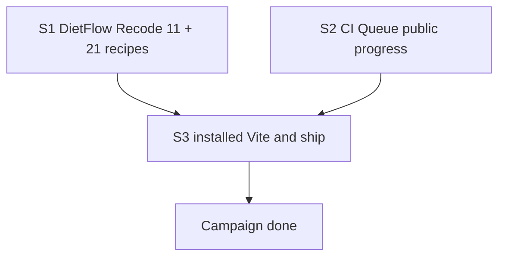

# WARLOG: Prova local com progress visível e ship sem Actions

## Mission

The operator sees DietFlow and CI Queue tests as jobs on the installed Vite queue, and merges through ship without GitHub Actions. Continuous progress missing is a warning, never a merge refusal.

## Scope

- In: DietFlow Recode 11 (catalog membership, material predicate, latest-attempt, Mac fail-closed); 21 test recipes instrumented; CI Queue derived `progressEnabled` + default Alert; installed-queue occupancy and ship of both lanes.
- Out: Editing `~/dietflow-app`; copying `src/ship` into DietFlow; vitest/Jest writing the live queue; `gh pr merge`; `runtime-probe` as proof; collector/UI forks; unifying the two remote-verdict files.

## Context

- Created: 2026-09-18
- Route: analyst_prd
- Phase budget (package): deep
- Confidence: medium
- Source: inline package `specs/001-prova-local-progress-ship`

## Campaign map

## Sprints

### S1 — DietFlow pack: catalog ship and visible progress

- State: ready
- Depends on: —
- Budget: spec
- Route: Analyst → Build → Plan → Execute → QA
- Human gate: never edit `~/dietflow-app`; worktree `dietflow-ci-queue-node-pin` only
- Green contract: Jest on ticket contract, ship controller, and progress instrumentation; Mac without queue is `LOCAL_RED`; 21 test recipes declare or emit progress; `runtime-probe` stays off
- Harness: existing DietFlow Jest
- Artifacts: `PRD.md`, `analysis.md`, `SPEC.md`, `implementation_plan.json`
- Next action: Execute subtask-1-1 (positive ratchet) when the operator starts Execute

### S2 — CI Queue derived progress field and default Alert

- State: ready
- Depends on: S1 predicate isolation (no edge B→A; S2 must not change `evaluateForRecipe`)
- Budget: spec
- Route: Plan → Execute → QA
- Human gate: none
- Green contract: `public_job` derives `progressEnabled` and hides `flags`; unconfigured recipe shows the invariant default Alert; job status stays non-failed
- Harness: existing `python3 -m unittest discover -s tests/backend` and `npx vitest run tests/ui`
- Artifacts: `implementation_plan.json` phase-4
- Next action: after S1 Track A, or in series under `execution_strategy: single`

### S3 — Review, activate the release, observe Vite, then ship each lane

- State: blocked
- Depends on: S1, S2
- Budget: plan
- Route: Execute → review → release → observe → ship → QA
- Human gate: one LaunchAgent worker; `gh` identity per repo; specs versioned; no ignore-to-clean
- Green contract: code review before install; `/build.json` matches the bundle; instrumented tickets show stages; undeclared tickets show the Alert; DietFlow `npm run ship` then CI Queue `ci-queue ship --no-remote`, separately, on frozen HEADs; no `gh pr merge`
- Harness: live queue after existing installer, not the product suite and not the git checkout dashboard
- Artifacts: —
- Next action: wait for S1 and S2 GREEN, then 5-1 review

## Decisions

- Recode 11: `acceptedPresets` is unique membership; predicate has no `projectId`; latest attempt by `startedAt`; enqueue default `[0]`; Darwin fail-closed via `ShipOps.platform()`.
- Two clocks: `startedAt` chooses the attempt; `finishedAt` chooses which eligible latest to reuse.
- Full advisory is not a merge ticket.
- Track B never feeds Track A.
- Plan Vite observation is operational evidence, not a product test.

## Event Log

- 2026-09-18 | analyst | Recode 11 destilled; PRD ready.
- 2026-09-18 | build | `SPEC.md` written; R1 Sol + GPT R2 recoded.
- 2026-09-18 | plan | `implementation_plan.json` TDD I1 complete. Execute not started.
- 2026-09-18 | plan | Pre-execute review: code review before ship; release activation before installed Vite; distinct stages vs Alert; ticket identity flags; emitter cycle; no ignore specs/; ships not chained.

## Risks And Blocks

- Dirty `specs/` tree blocks CI Queue ship until this package is committed.
- Second worker while LaunchAgent lives.
- Enqueue without `--config` from a DietFlow cwd tags the wrong recipe.
- Treating checkout `npm run check` as pass repeats the original bug.

## Next Action

- Execute subtask-1-1 in `dietflow-ci-queue-node-pin`.
