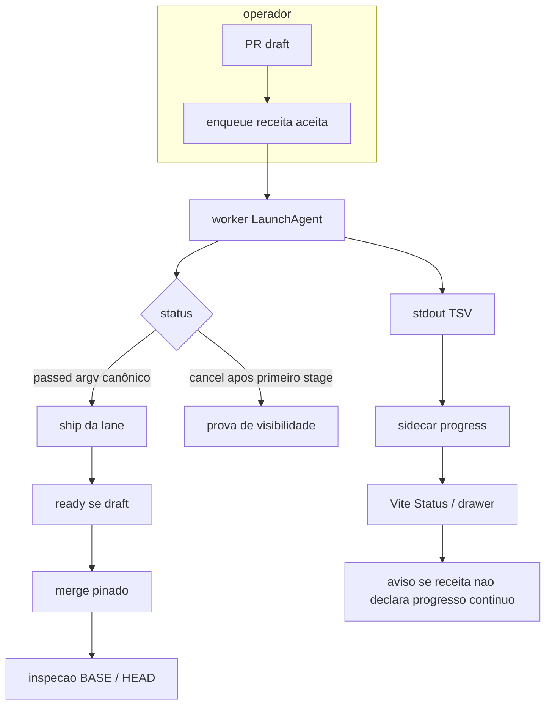

# Analyst: Prova local com progress visível e ship sem Actions

## State

- Source: inline + PRs mergeados (#10, #1291, #1292) + `research/00-index.md`
- Route: analyst_prd
- Phase budget: deep
- Confidence: medium
- Created: 2026-09-18
- Verdict: needs human decision (PRD `gathering`; Build bloqueado até confirmação)
- Mindset: `feature-mindset-contract.md` (facetas, não waterfall)

## TL;DR

O terreno executa o happy path: enqueue, worker, TSV se a receita declara, Vite, ship sem Actions. Progresso contínuo ausente é aviso, não recusa — decisão do operador em 2026-09-18. `full`/`smoketest`/`check` são nomes do consumidor; o produto conhece o pacote de ship. Viável sem collector novo. Código ainda devido: Alert de configuração, expor `progressEnabled` no JobRecord, alinhar `acceptedPresets` com o que o DietFlow já aceita como prova, ratchet, emissores, fallback fora da fila. Build bloqueado até confirmação humana do restante do PRD.

## Síntese

A promessa é occupancy na fila local e merge pelo pacote de ship — não um terminal verde no checkout, e não uma árvore de estágios como condição de merge. O backend já produz `ticket.progress` quando a receita declara `progress: true`; o ship já recusa argv errado e base andada e **continua** ignorando progress na elegibilidade, agora de propósito. A composição Vite já tem Status + drawer Progresso; falta um `Alert` padrão quando a receita não declara, o que exige o booleano no JobRecord público. Copy do aviso é invariante de configuração, sem tom de falha. Tirar o ticket ou tirar o ship devolve o bug original. Tirar os estágios só acende o aviso.

## Phase 0 Grill

| Signal | Verdict | Notes |
|---|---|---|
| Action clear | pass | Anotar dívida + contrato de ativação; Build só após confirmação. |
| Persona clear | pass | Marco no Vite; dois agentes anteriores; worker único. |
| Input/output clear | pass | Input: PRs + fila instalada + pedido. Output: PRD gathering + analysis + research. |
| Scope clear | pass | Spec só CI Queue; DietFlow código depois na worktree; sem spec DietFlow. |
| Objective criteria clear | pass | Ticket id no state instalado + ship, não suíte tmp. Visibilidade = iniciar; merge = `passed`. |

Ambiguity points: 0 nas decisões de progress/ship-pack (operador fechou em 2026-09-18). Build ainda espera confirmação explícita da fase.

## Source And Scope

- Input source: pedido inline; `research/01`–`04`; código CI Queue `f4f502e`; DietFlow worktree `dietflow-ci-queue-node-pin`.
- Mode: hybrid (extraction do terreno + construction do contrato de fecho).
- In scope: viabilidade, dívida, DoDs, mapa de patch DietFlow, crítica de over-engineering.
- Out of scope: SPEC/código, cutover `ci-queue ship` no DietFlow, sandbox Node, vitest contra fila live, editar `dietflow-app`.
- Assumptions: um LaunchAgent worker no state `local-ci/queue`; confirmação humana antes do Build; visibilidade ≠ elegibilidade de ship.

## Faceta — Produto

**Promessa:** o operador vê o teste nascer na fila local (DietFlow e CI Queue) e o ship mergeia em `dev` sem Actions.

**Jornada mínima:** PR draft → enqueue da receita aceita no state instalado → primeiro stage no Vite (pode cancelar) → receita `passed` se for mergear → ship (DietFlow `npm run ship` / CI Queue `ci-queue ship --no-remote`) → ready → merge pinado.

**Superfície:** dashboard Vite já instalado (Status “execução atual”, drawer do job, aba Progresso, seletor de projeto). Sem modal novo. Sem botão de ship (contrato: dashboard não mergeia).

**Non-goals:** Full como prova; last-green; `runtime-probe` como proof; `npm run check` / `ci:smoketest` fora da fila; `gh pr merge` avulso; push em `origin/dev`; card de runtime; segundo worker; fail-closed sem registry.

## Faceta — Backend (dados reais)

| Path | Lines | Payload / fact | Confidence |
|---|---:|---|---|
| `ci-queue.json` | 13-27 | Preset `check`: argv `["npm","run","check"]`, `progress: true`, ship-bound; `acceptedPresets: ["check"]`; sem `remoteVerdict` | high |
| `src/core/enqueue.ts` | 79 | `progress` do catálogo → `ticket.flags.progressEnabled` | high |
| `src/core/runner.ts` | 446-465, 587-624 | `LOCAL_CI_PROGRESS_ENABLED=1` só com a flag; collector no stdout; spawn `ticket.cwd` | high |
| `src/core/progress.ts` | 18-20, 174-179 | Aceita `@@ci-queue-progress` e `@@local-ci-progress`; sidecar `progress/<id>.json` | high |
| `backend/ci_queue_api/records.py` | 158-273 | Running lê sidecar; terminal usa `job.progress`; `progressSummary` | high |
| `src/ship/eligibility.ts` | 202-215 | Elegibilidade: preset+argv+cwd+HEAD+B0; nome da receita não basta | high |
| `src/ship/ship.ts` | 202-206, 299-314 | `wait` sem `remoteVerdict` → `SHIP_CONFIG`; `--no-remote` → skipped; draft `markReady` | high |
| `src/ship/system-ops.ts` | 45, 610-630, 736-749 | Verdict file ao lado do catálogo; `BASE_MOVED`; PUT merge `sha=H` | high |
| `scripts/ci/check-with-progress.sh` | 12-36 | Emite quatro stages mesmo sem consultar a env | high |
| `src/ship/system-ops.ts` | 239-247 | `recipeFlags` **omite** `progressEnabled` e `abortOnStaleBase` | high |
| `src/ship/eligibility.ts` | 84-90, 116-155 | Match de flags sem progress; `evaluateForRecipe` não lê `ticket.progress` | high |
| DietFlow `scripts/ci/queue-ticket-contract.ts` | 262-283 | `isQueueMaterialProofEligible` ignora progress | high |
| DietFlow `scripts/ship/ship.ts` | 335-337, 369-375 | `full` antes de smoketest; sem fila → `ci:smoketest` direto, sem ticket | high |
| `backend/ci_queue_api/records.py` | 307-319 | Running/queued globais; history filtrada por `projectId` | high |
| DietFlow `ci-queue.json` | 342-345 | `acceptedPresets: ["smoketest"]` — lido pelo **produto**, não por `npm run ship` | high |
| DietFlow `scripts/ci/__tests__/progress-instrumentation.test.ts` | 87-152 | Ratchet `stillSilent === []` proíbe 13º `progress: true` | high |
| `~/.local/state/local-ci/queue/history/20260918030255-9d3a6e7e.json` | runtime block | Única prova instalada do pin: `runtime-probe`, `node -p`, `verified` / `24.20.0` | high |
| Enqueue `check` 2026-09-18 no state instalado | — | UNPROVEN (zero arquivos `preset=check` nesse dia) | high (ausência) |
| `register --version 99.0.0` no state instalado | — | UNPROVEN (claim do PR #1292; grep 0 hits) | medium |

Shape que a tela recebe (job running): `progressSummary.roots[]` com id/label/status; drawer lê `job.progress.nodes`. Sem `progressEnabled`, emissores DietFlow no-op; o wrapper CI Queue ainda emite TSV, mas o caso de produto declara a flag.

## Faceta — Frontend (reuso antes de criar)

Grep + `.context/domains/manifest.yaml` (CI Queue). DietFlow `.context/patterns/ci.yaml` para a norma futura. Nenhum `new` de UI.

| Need | Guard source `graph` \| `grep` \| `both` | Decision `reuse` \| `mode` \| `new` | Evidence path / canônico |
|---|---|---|---|
| Árvore de progress do job | both | reuse | `ui/src/features/shared/job-drawer.tsx`; `ui/src/features/status/status-page.tsx`; manifest `system_map.status` |
| Aviso receita sem progresso contínuo | grep | mode | `Alert` já usado em `job-drawer.tsx` para `failureReason` — variante padrão, não `destructive`; Empty “Progresso não registrado” não é o copy |
| Occupancy / tabela de runs | both | reuse | `ui/src/features/shared/run-table.tsx` |
| Seletor de projeto | both | reuse | `ui/src/features/projects/project-switcher.tsx` |
| Card de runtime | grep | reuse (não criar) | Non-goal do pin |
| Botão ship no dashboard | grep | reuse (não criar) | `docs/CONSUMER-QUICKSTART.md` |
| Emissor de stages do `check` | grep | reuse | `scripts/ci/check-with-progress.sh` |
| Enqueue / ship CLI | grep | reuse | `src/cli.ts`; `src/ship/ship.ts` |
| Elegibilidade com progress | grep | reuse | **não** estender para recusar; `eligibility.ts` permanece git+argv |
| Flag progress nas receitas DietFlow restantes | grep (DietFlow) | mode | `ci-queue.json` + inverter ratchet |
| Collector / protocolo TSV | grep | reuse | `src/core/progress.ts` |
| `advisory upsert` para o aviso | grep | reuse (não usar) | Outro objeto: recomendação de validação por preset+PR |

UI canônica: drawer tab Progresso + Status roots (`job-drawer.tsx`, `status-page.tsx`). Prova: ticket no state instalado. Proibido: grid paralelo, vitest na fila live, segundo worker, botão de ship no dashboard.

## Faceta — Copy (strings-safadas)

Nenhuma string nova de produto nesta fase. Chrome existente. Norma em docs.

| Superfície | Texto candidato / mock | Pecado? | Destino: invariante \| estrutura \| morte |
|---|---|---|---|
| Aba do drawer | Progresso | não | invariante (já instalada) |
| Nó collector | Artefatos | não | invariante (já instalada) |
| Alert título | Progresso contínuo não configurado | não | invariante |
| Alert descrição | Esta receita não declara progresso contínuo. Os estágios da execução não aparecem. | não | invariante |
| Empty antigo | Progresso não registrado | sim, se ficar como copy do caso “não configurou” | morte ou só “declarou e não emitiu” |
| Docs/AGENTS | Receita de teste nova declara progress e emite o protocolo. | não | invariante |

## Recode Log

| When | Trigger (evidence) | Facet that broke | What was recoded |
|---|---|---|---|
| 2026-09-18 recon 1 | `research/01`: wrapper emite TSV; collector+Vite fechados; testes proibidos de tocar a fila live | Produto | “Falta pipeline de progress” → falta **enqueue no state instalado**. Suíte tmp é isolamento contratado, não prova de occupancy. |
| 2026-09-18 recon 2 | `research/04`: merge CI Queue é PUT `sha=H`; DietFlow ship já skipped | Backend | “Não tem comando de merge sem Actions” → tem. #10/#1292 usaram `gh pr merge`. Sem `--no-remote` o ship **recusa**, não espera o Actions. |
| 2026-09-18 recon 3 | `research/02`: `19c491a3f` push direto; #1291 tem attestation estilo ship mas test plan `[ ] ship` | Produto | “#1291 foi push em dev” → só o commit de catálogo. O PR de progress mergeou; a prova Vite não tem ticket id. |
| 2026-09-18 recon 4 | `research/03`: único job instalado = `node -p` sujo; `99.0.0` ausente no state | Backend | “Pin provado na fila” → pin instalado, prova = identity probe. `check` do produto não rodou como ticket. |
| 2026-09-18 recon 5 | Ratchet `stillSilent === []` | Backend + Produto | Extra “todo teste como full/smoke” **não** é só procedimento: o teste DietFlow **quebra** o 13º flag. |
| 2026-09-18 recon 6 | `research/05` + `system-ops.ts:239-247` + `eligibility.ts:116-155` | Backend | Ship aceita prova sem estágios. Na época tratado como dívida de recusa. |
| 2026-09-18 recon 7 | Operador: progress não obrigatório; aviso; ship é pacote, não nome full/smoke | Produto + Backend + Frontend + Copy | Recusa no ship **sai do escopo**. `full` vale se usa o mesmo pacote. Aviso = `Alert` padrão + booleano público. Empty atual não serve. |

Invariante → código que impõe hoje → gap:

| Invariante | Quem impõe hoje | Gap |
| --- | --- | --- |
| Ticket na fila instalada | operador (enqueue) | suíte tmp não cria ticket |
| TSV no Vite se `progress: true` | runner + collector + UI | nenhum, se enqueue certo |
| Merge sem Actions | `--no-remote` / verdict skipped | invocação; não feature nova |
| Progresso contínuo ausente | empty “não registrado”; flag não vai à API | `Alert` padrão + booleano público |
| Smoketest vs full | DietFlow ship aceita os dois; catálogo produto só `smoketest` | alinhar `acceptedPresets` |
| Todo teste DietFlow com progress | **não** (ratchet + emissores) | catálogo/mode; aviso se faltar |

## Product Promise

Marco precisa ver o job na fila e mergear sem crédito de Actions. Estágios são contrato de receita. Falta deles = aviso. Sucesso: ticket ids + ship do pacote.

## Story de Usuario

Como operador, se eu não vejo o job no Vite, o teste não aconteceu no produto que eu uso. Se o merge sai de `gh pr merge`, o pack de prova local foi teatro.

## Story Tecnica

Enqueue contra o catálogo certo; ship reusa argv da receita **aceita como prova**. UI mostra ocupação e, se a receita não declara progresso contínuo, um aviso. DietFlow: catálogo + emissores + norma; `full` no mesmo pacote que `smoketest` se já é prova. Sem superfície nova além do `Alert` existente.

## Current Terrain

Ver PRD seções Relato + Comandos + Dívida. Fatos duros:

- Pré-pin (`61069f4`) já tinha `check`+progress+ship+spend-abort.
- Testes do produto isolam HOME/state de propósito.
- DietFlow 12/34 presets com progress; 22 mudos; ratchet negativo.
- Pin instalado; `runtimes.json` só DietFlow.
- Dois controllers de ship; dois verdict files no DietFlow.
- Ship **não** exige `progressEnabled` — e a decisão do operador manda manter assim.
- DietFlow ship aceita `full` e `smoketest`; o bloco `ship` do catálogo lista só `smoketest`.
- Running Vite é global; histórico é por projeto.

## Evidence Matrix

| Path | Lines | Fact | Confidence |
|---|---:|---|---|
| `research/01-ci-queue-progress-ship.md` | 369-377 | O que merecia ser job vs o que rodou em tmp | high |
| `research/02-dietflow-progress-ship.md` | 116-168, 329-367 | Inventário presets + files to patch | high |
| `research/03-node-pin-actual-vs-dod.md` | 156-205, 227-237 | Probe vs check; testes que o pin deveria ter feito | high |
| `research/05-gpt-sol-critique.md` | — | Ship não exige progress; `full` vs smoke; fallback direto | high |
| `docs/superpowers/plans/2026-09-17-ci-queue-plug-and-play.md` | 27-29 | Suíte não toca a fila do operador | high |
| `tests/examples/init-ship.test.mjs` | 20, 317 | `assert.notEqual(state, OPERATOR_QUEUE)` | high |

## Implementation Map

| Area | Path | Role | Decision |
|---|---|---|---|
| Context / entry | `.context/domains/manifest.yaml` | Status/drawer canônicos | reuse |
| Backend contracts | `src/contracts/config.ts`, `docs/CONTRACTS.md` | Parse progress/ship; protocolo TSV | reuse |
| Services / hooks / state | `src/core/enqueue.ts`, `runner.ts`, `progress.ts`, `src/ship/*` | Ticket, env, collector, merge | reuse |
| Public job | `backend/ci_queue_api/records.py` `public_job` | Expor declaração de progresso contínuo | mode |
| DietFlow catalog | `ci-queue.json`, `progress-instrumentation.test.ts` | Flags + ratchet | mode (depois da confirmação) |
| DietFlow emitters | `e2e-local-stack.sh`, `smoketest-local.sh`, scripts mudos | TSV | reuse stack; new só nos wrappers sem stack |
| DietFlow ship | `scripts/ship/ship.ts` | Skip remote + smoke | reuse |
| Shells / shared primitives | `job-drawer.tsx`, `status-page.tsx` | Progress UI | reuse |
| Frontend composition | nenhuma nova | — | reuse |
| Docs / AGENTS | DietFlow `docs/ci/*`, `.context/patterns/ci.yaml`, `AGENTS.md` | Norma receita nova | mode |
| Tests / proof | fila instalada (operador/QA); Jest ratchet | visibilidade vs merge | **não** live-state unit |

## Entities And State

```text
ENTITY: Ticket
- Attributes: id, preset, argv, cwd, projectId, flags.progressEnabled, headSha, baseSha, status, progress, runtime?
- Actions: enqueue, run, cancel, collect progress, persist history
- Relations: Project, ProgressSnapshot, ShipTarget
- Source of truth: <state>/history/<id>.json (sidecar progress enquanto running)
- Runtime states: queued, running, passed, failed, cancelled
- Invalid states to prevent: passed sem argv aceito contando como ship; aviso de progresso contínuo com `variant=destructive`

ENTITY: ProgressSnapshot
- Attributes: nodes (id, label, status)
- Actions: ingest TSV, copy into ticket
- Source of truth: sidecar then ticket.progress
- Invalid: inventar tendência/linha no Analysis (outro contrato de UI)

ENTITY: ShipTarget
- Attributes: PR, H, B0, catalog digest, remote policy
- Actions: attest, markReady, merge pinned, abort BASE_MOVED
- Relations: eligible Ticket
- Invalid: wait sem remoteVerdict; merge se HEAD andou; runtime-probe como proof

ENTITY: RuntimeBinding
- Attributes: projectId, node executable, version
- Source of truth: runtimes.json
- Invalid: tratar verified como sandbox; usar probe como smoketest
```

## Runtime / Data Flow



## Rules And Invariants

1. Sem ticket no state instalado, a task não passa.
2. Occupancy running é global; histórico terminal exige projeto selecionado.
3. Merge: ticket `passed`, argv da receita aceita como prova, cwd da lane, HEAD=H, base=B0. Progresso contínuo **não** entra na elegibilidade.
4. DietFlow merge: `npm run ship`; receitas de prova = o pacote (`smoketest` e `full` se `full` leva os mesmos flags e a mesma lista). Sem fila persistente no Mac: recusar, não `ci:smoketest` direto.
5. CI Queue merge: receita `check`; `ci-queue ship --no-remote`; não `gh pr merge`.
6. Um worker. Worker não mergeia.
7. Suíte de produto não escreve na fila do operador.
8. Receita DietFlow nova: `progress: true` + emissor + norma docs/AGENTS. Falta = aviso.
9. `runtime-probe` não é proof de ship.
10. `runtimes.json` não cadastra o projeto no Vite.

## Blueprint Handoff

- Files / areas: `public_job` + drawer `Alert`; catálogo DietFlow; emissores; docs/AGENTS; `acceptedPresets` alinhado. Sem recusa no ship. Sem JSX de composição nova.
- Product: occupancy visível; ship mergeia o pacote; aviso se a receita não declara progresso contínuo.
- Backend: reusar enqueue/collector/eligibility; mode só no payload público do booleano.
- Frontend: reusar drawer/Status/`Alert`.
- Copy: o par título+descrição do aviso, invariante.
- Testable behaviors for Plan (names only):
  - queued check shows occupancy while running even if another project is selected
  - recipe without progress declaration shows the continuous-progress warning
  - warning does not mark the job failed
  - passed check without progress remains ship-eligible
  - passed check with recipe stages remains ship-eligible
  - ship no-remote merges pinned head without Actions wait
  - ship aborts when base moved
  - DietFlow full proof uses the same stability pack as smoketest
  - DietFlow without persistent queue fails closed on Mac
  - DietFlow catalog ratchet allows additional test presets with progress
  - runtime-probe remains ineligible for ship
- Sequence: humano confirma o PRD restante → Build SPEC → Plan TDD → Execute.
- Validation: ticket ids + aviso no drawer + ship logs. Sem comando de teste inventado aqui.

## Grill Verdict

**needs human decision** (Build ainda espera “pode Build”)

Decisões de progress e de `full`/pacote estão fechadas. Pacote **não** ready for build só porque o operador pediu confirmação da fase.

Terreno: happy path suportado. Recusa por progress **fora**. Crítica `research/05` parcialmente invertida pelo operador (recode 7).

Não split. DietFlow sem spec.

Viável: aviso + contrato + alinhar `acceptedPresets`. Over-engineering: recusar no ship, `advisory upsert`, collector novo.

## Open Questions

Nenhuma de produto. Build espera confirmação de fase.

## Recommended Next Phase

Esperar correção/confirmação do PRD. Então Build (`SPEC.md`). Não Execute agora.
