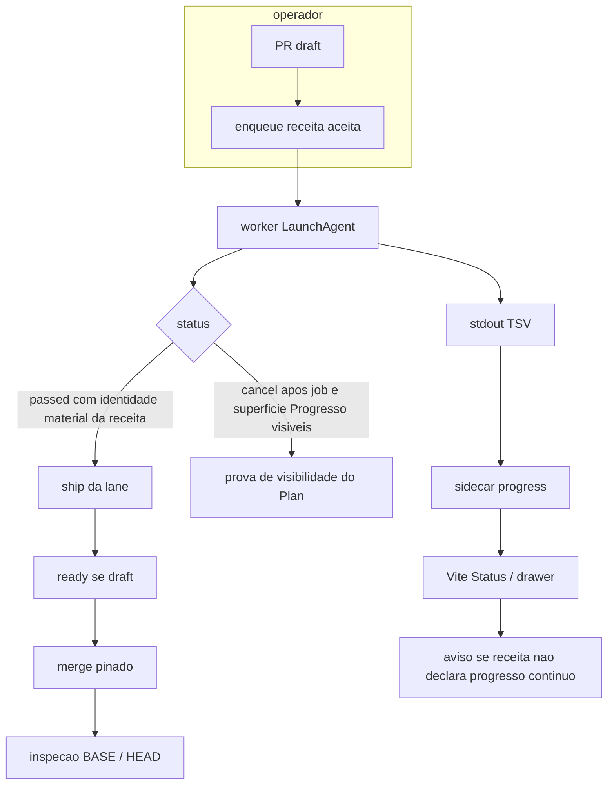

# Analyst: Prova local com progress visível e ship sem Actions

## State

- Source: pedido inline; PRs mergeados (#10, #1291, #1292); código CI Queue `f4f502e`; DietFlow worktree `dietflow-ci-queue-node-pin`; fila instalada `~/.local/state/local-ci/queue`
- Route: analyst_prd
- Phase budget: deep
- Confidence: medium
- Created: 2026-09-18
- Verdict: prd_ready (operador autorizou Build 2026-09-18; Recode 11 fechado)
- Mindset: `feature-mindset-contract.md` (facetas, não waterfall)
- Este arquivo é a destilação. Pasta `research/` é arquivo bruto, não fonte. Contratos, autópsia, comandos e inventário nomeado moram aqui.

## TL;DR

O terreno executa o happy path: enqueue, worker, TSV se a receita declara, Vite, ship sem Actions. Duas barras, não misturar. **Produto:** progresso contínuo ausente é aviso, nunca recusa de ticket ou merge. **Plan:** o fechamento operacional deve observar no Vite da fila instalada o job e a superfície de Progresso (estágios se instrumentado; aviso se não declara). Isso nunca é condição de `passed`, elegibilidade ou merge. `full`/`smoketest`/`check` são nomes do consumidor. **Resolver, não documentar:** o DietFlow não sai desta spec com uma segunda definição independente de prova material. `ci-queue.json#ship.acceptedPresets` é a única fonte de membership; o controlador resolve argv+flags dali; predicado forte; latest canonical attempt; Mac sem fila = `LOCAL_RED`. Viável sem collector novo, sem controller paralelo, sem `projectId` no predicado DietFlow. Operador autorizou Build 2026-09-18. `SPEC.md` implementa Recode 11; não escolhe outra arquitetura.

## Síntese

A promessa de **produto** é occupancy na fila local e merge pelo pacote de ship — não um terminal verde no checkout, e não uma árvore de estágios como condição de merge. O fechamento operacional do Plan deve observar no Vite da fila instalada o job executado e sua superfície de Progresso. Para receita instrumentada, os estágios esperados; para receita sem declaração, o aviso previsto. Essa observação é evidência operacional do Plan/Execute e nunca condição de `passed`, elegibilidade ou merge. O backend já produz `ticket.progress` quando a receita declara `progress: true`. O ship do **CI Queue** já valida identidade material (`evaluateForRecipe`, inclusive `projectId` — problema multi-projeto do executor). O ship do **DietFlow** hoje não; Recode 11 **elimina** essa assimetria no predicado DietFlow **sem** importar `projectId`. Os dois **continuam** ignorando progress na elegibilidade, de propósito. Não há aresta B→A: progress nunca autoriza nem recusa merge.

## Phase 0 Grill

| Signal | Verdict | Notes |
|---|---|---|
| Action clear | pass | Dívida + contrato anotados; Build autorizado 2026-09-18. |
| Persona clear | pass | Marco no Vite; dois agentes anteriores; worker único. |
| Input/output clear | pass | Input: PRs + fila instalada + pedido. Output: PRD ready + analyst + SPEC. |
| Scope clear | pass | Spec só CI Queue; DietFlow código depois na worktree; sem spec DietFlow. |
| Objective criteria clear | pass | DoD de plano: observar job + superfície de Progresso no Vite (não é teste de produto). DoD de produto: aviso se faltar declaração; ship ignora progress. Recode 11 fecha o pacote DietFlow. |

Ambiguity points: 0 nas decisões de progress, pacote de ship e Recode 11 (operador fechou 2026-09-18). Build autorizado; SPEC não escolhe outra arquitetura.

## Source And Scope

- Input source: pedido inline; código CI Queue `f4f502e` e ancestral `61069f4`; DietFlow worktree `dietflow-ci-queue-node-pin`; state instalado; PRs #10 / #1291 / #1292.
- Mode: hybrid (extraction do terreno + construction do contrato de fecho).
- In scope: viabilidade, dívida, DoDs, autópsia, **eliminar** a assimetria do pacote DietFlow (catálogo fonte única, predicado material, latest-attempt, Mac fail-closed), mapa de patch das receitas **ativas** (trilha B), crítica de over-engineering.
- Out of scope: código de produto nesta passagem, cutover `ci-queue ship`, copiar `src/ship/*`, `projectId` no predicado DietFlow, unificar `remote-verdict.json`, sandbox Node, vitest contra fila live, editar `dietflow-app`, 350 arquivos como 350 presets.
- Assumptions: um LaunchAgent worker no state `local-ci/queue`; visibilidade ≠ elegibilidade de ship.

## Faceta — Produto

**Promessa:** o operador vê o teste nascer na fila local (DietFlow e CI Queue) e o ship mergeia em `dev` sem Actions.

**Jornada mínima:** PR draft → enqueue da receita no state instalado → o job aparece no Vite → a superfície de Progresso mostra estágios **ou** o aviso de não configurado → receita `passed` se for mergear → ship (DietFlow `npm run ship` / CI Queue `ci-queue ship --no-remote`) → ready → merge pinado. Cancelar depois de ver job+superfície prova só visibilidade.

**Superfície:** dashboard Vite já instalado (Status “execução atual”, drawer do job, aba Progresso, seletor de projeto). Sem modal novo. Sem botão de ship (contrato: dashboard não mergeia). Título do job = nome da receita (`preset`). Nomes dos casos Playwright moram na árvore de progresso, não no card de occupancy.

**Non-goals:** last-green como prova de ship (verde antigo da mesma receita se a tentativa canônica posterior falhou); `full` **fora** do catálogo `acceptedPresets`; `runtime-probe` como proof; `npm run check` / `ci:smoketest` fora da fila no Mac desta dívida; `gh pr merge` avulso; push em `origin/dev`; card de runtime; segundo worker; `projectId` no predicado DietFlow; fail-closed universal em cloud/Linux; case-level de Jest no drawer; um preset por arquivo de spec.

**Goal invertido (não é non-goal):** `full` **é** prova quando está em `ship.acceptedPresets` e a execução concreta passa o predicado material (argv+flags+git+cwd+latest-attempt). O nome não substitui o pacote. A lista sozinha tampouco. `ProofPreset` hardcoded morre.

## Faceta — Backend (dados reais)

| Path | Lines | Payload / fact | Confidence |
|---|---:|---|---|
| `ci-queue.json` | 13-27 | Preset `check`: argv `["npm","run","check"]`, `progress: true`, ship-bound; `acceptedPresets: ["check"]`; sem `remoteVerdict` | high |
| `src/core/enqueue.ts` | 79 | `progress` do catálogo → `ticket.flags.progressEnabled` | high |
| `src/core/runner.ts` | 446-465, 587-624 | `LOCAL_CI_PROGRESS_ENABLED=1` só com a flag; collector no stdout; spawn `ticket.cwd` | high |
| `src/core/progress.ts` | 18-20, 174-179 | Aceita `@@ci-queue-progress` e `@@local-ci-progress`; sidecar `progress/<id>.json` | high |
| `backend/ci_queue_api/records.py` | 158-273 | Running lê sidecar; terminal usa `job.progress`; `progressSummary` | high |
| `src/ship/eligibility.ts` | 116-155, 202-215 | `evaluateForRecipe`: `projectId`, argv da receita, flags ship-bound, cwd, HEAD, B0; nome da receita **não** basta | high |
| `src/ship/ship.ts` | 202-206, 299-314 | `wait` sem `remoteVerdict` → `SHIP_CONFIG`; `--no-remote` → skipped; draft `markReady` | high |
| `src/ship/system-ops.ts` | 45, 610-630, 736-749 | Verdict file ao lado do catálogo; `BASE_MOVED`; PUT merge `sha=H` | high |
| `scripts/ci/check-with-progress.sh` | 12-36 | Emite quatro stages mesmo sem consultar a env | high |
| `src/ship/system-ops.ts` | 239-247 | `recipeFlags` **omite** `progressEnabled` e `abortOnStaleBase` | high |
| `src/ship/eligibility.ts` | 84-90, 116-155 | Match de flags sem progress; `evaluateForRecipe` não lê `ticket.progress` | high |
| DietFlow `scripts/ci/queue-ticket-contract.ts` | 262-283 | `isQueueMaterialProofEligible`: preset + queue + passed + cwd + pré/pós Git. **Não** compara argv, `projectId` nem flags ship-bound. Ignora progress | high |
| DietFlow `scripts/ship/ship.ts` | 335-337, 369-375 | `full` antes de smoketest; sem fila → `ci:smoketest` direto, sem ticket | high |
| `backend/ci_queue_api/records.py` | 307-319 | Running/queued globais; history filtrada por `projectId` | high |
| DietFlow `ci-queue.json` | 342-345 | `acceptedPresets: ["smoketest"]` — lido pelo **produto**, não por `npm run ship` | high |
| DietFlow `scripts/ci/__tests__/progress-instrumentation.test.ts` | 87-152 | Ratchet `stillSilent === []` proíbe 13º `progress: true` | high |
| DietFlow `scripts/ci/playwright-progress-reporter.ts` | 6, 64-75 | Casos `pw:<sha1>`; label = `titlePath`; teto `MAX_CASE_NODES = 100` | high |
| `~/.local/state/local-ci/queue/history/20260918030255-9d3a6e7e.json` | runtime block | Única prova instalada do pin: `runtime-probe`, `node -p`, `verified` / `24.20.0` | high |
| Enqueue `check` 2026-09-18 no state instalado | — | UNPROVEN (zero arquivos `preset=check` nesse dia) | high (ausência) |
| `register --version 99.0.0` no state instalado | — | UNPROVEN (claim do PR #1292; grep 0 hits) | medium |

Shape que a tela recebe (job running): `progressSummary.roots[]` com id/label/status; drawer lê `job.progress.nodes`. Sem `progressEnabled`, emissores DietFlow no-op; o wrapper CI Queue ainda emite TSV, mas o caso de produto declara a flag. Collector ingere TSV **independente** da flag; a flag só liga emissores que consultam `LOCAL_CI_PROGRESS_ENABLED`.

## Faceta — Frontend (reuso antes de criar)

Grep + `.context/domains/manifest.yaml` (CI Queue). DietFlow `.context/patterns/ci.yaml` para a norma futura. Nenhum `new` de UI.

| Need | Guard source `graph` \| `grep` \| `both` | Decision `reuse` \| `mode` \| `new` | Evidence path / canônico |
|---|---|---|---|
| Árvore de progress do job | both | reuse | `ui/src/features/shared/job-drawer.tsx`; `ui/src/features/status/status-page.tsx`; manifest `system_map.status` |
| Aviso receita sem progresso contínuo | grep | mode | `Alert` já usado em `job-drawer.tsx` para `failureReason` — variante padrão, não `destructive`; Empty “Progresso não registrado” não é o copy |
| Occupancy / tabela de runs | both | reuse | `ui/src/features/shared/run-table.tsx` |
| Seletor de projeto | both | reuse | `ui/src/features/projects/project-switcher.tsx` |
| Título do job | grep | reuse | `job-drawer.tsx` usa `job.preset`; não o path do spec Playwright |
| Card de runtime | grep | reuse (não criar) | Non-goal do pin |
| Botão ship no dashboard | grep | reuse (não criar) | `docs/CONSUMER-QUICKSTART.md` |
| Emissor de stages do `check` | grep | reuse | `scripts/ci/check-with-progress.sh` |
| Enqueue / ship CLI | grep | reuse | `src/cli.ts`; `src/ship/ship.ts` |
| Elegibilidade com progress | grep | reuse | **não** estender para recusar. DietFlow: mode no predicado material **sem** `projectId` e **sem** `progressEnabled`. Não copiar `src/ship/*` |
| Flag progress nas receitas DietFlow ativas | grep (DietFlow) | mode | `ci-queue.json` + inverter ratchet + emissores sem stack |
| Collector / protocolo TSV | grep | reuse | `src/core/progress.ts` |
| `advisory upsert` para o aviso | grep | reuse (não usar) | Outro objeto: recomendação de validação por preset+PR |

UI canônica: drawer tab Progresso + Status roots (`job-drawer.tsx`, `status-page.tsx`). Prova: ticket no state instalado. Proibido: grid paralelo, vitest na fila live, segundo worker, botão de ship no dashboard.

## Faceta — Copy (strings-safadas)

Nenhuma string nova de produto nesta fase além do par do aviso. Chrome existente. Norma em docs.

| Superfície | Texto candidato / mock | Pecado? | Destino: invariante \| estrutura \| morte |
|---|---|---|---|
| Aba do drawer | Progresso | não | invariante (já instalada) |
| Nó collector | Artefatos | não | invariante (já instalada) |
| Alert título | Progresso contínuo não configurado | não | invariante |
| Alert descrição | Esta receita não declara progresso contínuo. Os estágios da execução não aparecem. | não | invariante |
| Empty antigo | Progresso não registrado | sim, se ficar como copy do caso “não configurou” | morte ou só “declarou e não emitiu” |
| Docs/AGENTS | Receita de teste nova declara progress e emite o protocolo. | não | invariante |

## Autópsia — o que cada frente fez

Pedido original: relato. PRs, push em `dev`, probe sujo, `npm run check` em tmp, `gh pr merge` #10/#1292. Vive aqui. PRD só resume.

### Frente DietFlow progress/ship

Dois commits distintos. Não confundir.

1. **`19c491a3f`** — `chore(ci): bind smoketest as ci-queue ship proof with skipped remote verdict`. Dois arquivos: `pinHeadSha` em smoke/full, bloco `ship.acceptedPresets: ["smoketest"]`, `remote-verdict.json` **na raiz** (`skipped`). **Push direto em `origin/dev`.** Sem PR. Sem `npm run ship`. `gh api .../commits/19c491a3f/pulls` devolve lista vazia. Contraria o intuito do próprio commit: PR draft + prova local + ship sem crédito de Actions.

   Armadilha: DietFlow `scripts/ship/ship.ts` **não lê** `ci-queue.json#ship` nem o verdict da raiz. Lê `scripts/ship/remote-verdict.json` (já `skipped` desde #1224). O bloco `ship` do catálogo é contrato do **produto** (`ci-queue ship`). `npm run ship` continua hardcoded em `full` depois `smoketest` via `findLocalProofTicket` (`ship.ts:335-337`).

2. **`023a1810d` / PR #1291** — `progress: true` em seis presets que **já emitiam** via `e2e-local-stack.sh`: `receitas-medidas`, `regression`, `c1-conformance`, `c2-conformance`, `ledger-concurrency`, `p7-selection-search-lab`. Ratchet Jest que **congela** essa allowlist e **proíbe** o 13º flag. Merge `60bf35977` em 6 segundos, zero Actions. Test plan: Jest focado marcado; fila `p7` marcada **sem ticket id no git**; `npm run ship` **desmarcado**. Timeline tem attestation `local/smoketest` estilo ship — o checkbox de ship mesmo assim ficou vazio.

O que essa frente **não** fez: enfileirar o `check` do CI Queue; provar collector+Vite com o `check` canônico (e a suíte **não deve** escrever na fila live); norma em `AGENTS.md` / `.context/patterns/testing.yaml`; ligar as receitas ativas restantes.

### Frente pin (CI Queue #10 + DietFlow #1292)

Intent do pin: camada 1 opt-in, `runtimes.json` por `projectId`, `unconfigured` herda ambiente, `verified` = processos observados não sandbox, `env -i` continua non-goal.

O que mergeou: CI Queue #10 → `f4f502e`, release instalada `0.1.0-f4f502ed30fa`. DietFlow #1292: preset `runtime-probe` (`node -p`), `isValidPresetArgv` aceita `node`. Canonical `dietflow-app` **não** editado.

Prova instalada **única** do pin: ticket `20260918030255-9d3a6e7e`. `preset=runtime-probe`, cwd `dietflow-ci-queue-node-pin`, argv `node -p`, `headSha` ainda #1291 (`60bf35977`), árvore suja (`M ci-queue.json` etc.), `progress.nodes` = só Artefatos, `runtime.state=verified` / Node `24.20.0`. Commit `07df9a6aa` é **depois** do ticket. Provaram arquivos uncommitted.

Zero ticket `preset=check` em 2026-09-18. Últimos `check` do produto: 2026-09-17, sem `runtime`. Isolation tests escreveram `os.tmpdir()` (`/var/folders` → `/private/var`), nunca `~/.local/state/local-ci/queue`. `runtimes.json` instalado contém **só** DietFlow `da61d8ae-…`. CI Queue `070e4c47-…` nunca registrado: um `check` enfileirado hoje sairia `unconfigured`. Claim `register --version 99.0.0`: zero hits no state. UNPROVEN.

Merge das duas PRs do pin: o agente rodou `gh pr merge 10 --repo nmarcofernandess/ci-queue --merge` e `gh pr merge 1292 --repo dietflowoficial/Dietflow-app --merge`. Sem `--match-head-commit`. Sem `npm run ship`. Sem `ci-queue ship`. GitHub mostra merge commits de dois pais; a API **não** guarda a CLI. PROVEN pelo operador da sessão: nenhum controller de ship foi invocado.

O operador pediu para o primeiro agente testar na fila. Ele não testou. Passou a este. Este também não enfileirou `check` nem smoketest.

`npm run ship` **não** testa o runtime pin. `gh pr merge` tampouco.

## Terreno — pipeline e comandos que já existem

Pré-pin (`61069f4`) já tinha `check`+progress+ship+spend-abort. O pin só acrescentou `test:runtime` e `node-runtime-guard-v1`.

Cadeia de progress:

1. Catálogo `progress: true` → `flags.progressEnabled` (`enqueue.ts:79`).
2. Worker cria `ProgressCollector` sempre (`runner.ts:587-624`). stdout/stderr passam no decoder.
3. `LOCAL_CI_PROGRESS_ENABLED=1` só se a flag (`buildJobEnv`). Emissores DietFlow no-op sem isso. Wrapper `check-with-progress.sh` emite **mesmo sem** consultar a env (IDs `build`, `test`, `check-ui`, `browser`). Spec de design `2026-09-17-ci-queue-plug-and-play-design.md` ainda diz o contrário — stale; código + `tests/core/progress-emit.test.ts` são a verdade. Esse teste usa npm fake em tmp; **não** enfileira o `check` real.
4. Sidecar `progress/<id>.json` enquanto running; terminal copia para `ticket.progress` e apaga o sidecar.
5. API: running lê sidecar; occupancy running/queued é **global** (`records.py:307-319`); histórico terminal filtra por `projectId`.
6. Vite: Status usa `progressSummary.roots`; drawer tab Progresso usa `job.progress.nodes`. Worker sempre acrescenta o nó Artefatos no finalize — `nodes.length === 1` não prova receita instrumentada.

Máquina: state `~/.local/state/local-ci/queue`. CLI `~/.local/bin/ci-queue`. Worker LaunchAgent **sem** `--config`. Dashboard LaunchAgent `--config` DietFlow `dietflow-app/ci-queue.json` + o mesmo `--state`. Um worker. Segundo → `busy: true`.

### DietFlow (worktree da lane, não `dietflow-app`)

```bash
npm run ci:queue -- smoketest --wait
npm run ship -- --dry-run
npm run ship
```

`scripts/ship/remote-verdict.json` `skipped` → equivalente a `--no-remote`. Continua exigindo ticket material. `findLocalProofTicket` tenta `full` antes de `smoketest`. Merge: `gh pr merge --merge --match-head-commit <HEAD>` **chamado pelo ship**. `BASE_MOVED` no authorship e de novo antes do merge. Identidade Mac: `git user.name=Dietflowoficial` e `gh=dietflowoficial`. Sem fila persistente: `ci:smoketest` direto, **sem ticket** (`ship.ts:369-375`) — incompatível com o DoD de plano.

### CI Queue (conta `nmarcofernandess`)

```bash
ci-queue enqueue check \
  --config /Users/marcoantonio/ci-queue/ci-queue.json \
  --cwd /Users/marcoantonio/ci-queue \
  --state "$HOME/.local/state/local-ci/queue" \
  --json

ci-queue ship --dry-run --no-remote --json
ci-queue ship --no-remote --json
```

Não há script npm `ship`. Sem `--no-remote`, default `wait` recusa (`SHIP_CONFIG`) porque este repo **não tem** `remote-verdict.json` nem `ship.remoteVerdict`. Isso é invocação, não feature faltando. Merge: PUT `/pulls/{n}/merge` com `sha=H`, **não** `gh pr merge`. Occupancy do `check` running aparece no card global mesmo com o seletor em DietFlow. Histórico terminal exige cadastrar o projeto CI Queue no Project Manager. Cadastro ≠ `runtimes.json`.

`npm run check` fora da fila não produz ticket. `runtime-probe` não é accepted preset.

Obstáculos fail-closed já no código (não são dívida de feature): identidade DietFlow; ship recusa branch `dev`; árvore suja (este checkout com `specs/` untracked bloqueia ship até commit/ignore); `gh` DietFlow não resolve `nmarcofernandess/ci-queue`; catálogo tem de estar em H; cwd do ticket tem de ser a lane; um worker.

## Receitas ativas — retorno (fechado)

Três camadas. Não misturar.

1. **Job no Vite** = preset do `ci-queue.json`. São 34. Isso é o que a gente “mexe” no catálogo.
2. **O que o `full` varre** = arquivos dentro de **uma** receita. Spec 056 chama isso de E2E ativo / FAST_FLOW. Não são receitas.
3. **Os 10 principais do caminho para main** = Spec **115** `MATRIZ-CANONICA-RC.md`, não a 056.

Não achei 350 receitas. 34 presets + 114 specs FAST_FLOW + 57 regression + 2004 Jest. O 350, se existiu, era outro censo (casos/arquivos), não catálogo.

### O que a Spec 056 chama de ativo

Foto morta `CENSO-CI-ATUAL-2026-07-23.md`: **não é inventário vivo**. Ela mesma manda ler o fluxo vigente.

| Família 056 | 23/jul (censo) | 05/ago (reality check no resgate) | Vivo 2026-09-18 (`dietflow-ci-queue-node-pin`) |
| --- | ---: | ---: | ---: |
| E2E local `e2e/local/flows/**/*.spec.ts` | 79 | 85 | **114** arquivos |
| Desses, no sweep do `full`/`e2e` (menos atlas/proof opt-in) | — | — | **111** |
| Opt-in fora do `full` (`proof/`, `proof-atlas`, `care-pdf-atlas`) | — | — | **3** |
| Regression `e2e/regression/**/*.spec.ts` | 50 | 50 | **57** — **não** entra no `full` |
| JSONL do censo | 229 | — | foto; não é catálogo |

111 no `full`, por pasta: miniapp 83 (+ `care-pdf-atlas` opt-in = 84 no disco), golden 15, favoritos-conformance 3, export 2, realtime 2, receitas-medidas 2, `_harness` 1, root 1, policy 1.

056 **não** lista os dez gates. Ela classifica specs. Os dez são da 115.

### Os 10 do RC (Spec 115) — estes sim são jobs

| # | Preset | Progress hoje | O que falta nesta frente |
| --- | --- | --- | --- |
| 1 | `full` | já tem | nada no catálogo; 111 specs andam como filhos Playwright |
| 2 | `save` | já tem | nada no catálogo |
| 3 | `export-atlas` | mudo | emissor novo (`export-atlas-local.sh`) |
| 4 | `clinical-readonly-live` | mudo | emissor novo (`clinical-readonly-campaign.sh`; irmão `clinical-readonly` no mesmo arquivo) |
| 5 | `proof-favoritos-conformance` | mudo | **só flag** (já chama stack/golden) |
| 6 | `proof-importacao` | mudo | **só flag** (`importacao-local-stack.ts`) |
| 7 | `clinical-date-evolution` | mudo | emissor novo |
| 8 | `app-atlas` | mudo | emissor novo |
| 9 | `proof-receitas-medidas` | mudo | emissor novo (não confundir com preset `receitas-medidas`, que já tem progress) |
| 10 | `admin-relation` | mudo | emissor novo |

115 absorve no `full` (não viram gate extra): `smoketest`, `e2e`, `e2e-impact`, `receitas-medidas`, `flowui` isolado, `proof-care`. Continuam presets enqueueáveis. Enquanto existirem no catálogo, entram na ordem “ativas”.

### Já com `progress: true` (12) — não mexer o flag

`static`, `smoketest`, `full`, `e2e`, `e2e-impact`, `save`, `receitas-medidas`, `regression`, `c1-conformance`, `c2-conformance`, `ledger-concurrency`, `p7-selection-search-lab`.

### Vamos mexer (21 presets mudos de teste)

Ratchet **primeiro** (`stillSilent === []` quebra o 13º flag). Depois:

**Só `"progress": true`, argv congelado (11)** — já emitem Bootstrap→Playwright via stack/golden:

`proof-favoritos-anamnese`, `proof-favoritos-superficie`, `proof-modais-import-bulk`, `proof-colisao-save`, `proof-prescricao-importacao`, `proof-identidade-visivel`, `proof-selection-search-lab`, `proof-favoritos-conformance`, `proof-cross-module-conformance`, `proof-numeric-input`, `proof-importacao`.

**Emissor novo + flag (10)** — IDs estáveis, argv intocado:

`review`, `flowui`, `clinical-readonly`, `clinical-readonly-live`, `proof-care`, `proof-receitas-medidas`, `admin-relation`, `export-atlas`, `clinical-date-evolution`, `app-atlas`.

**Não mexer:** `runtime-probe` (identidade, não receita de teste). Não criar 111 nem 2004 presets. Regression da 056 já tem progress; não vira gate de ship. Jest permanece stage, não caso.

### Viável?

**Sim.** Ship **ignora** `progressEnabled`. Ligar flag / emissor não recusa merge, não muda argv, não muda o pacote de prova. Obstáculo mecânico único: inverter o ratchet **antes** do 13º flag. Os 11 goldens são baratos. Os 10 emissores são o trabalho real, lista fechada na tabela de wrappers do PRD. 111 specs no progress: **já cabe** como filhos de `e2e`/`full` (essas duas já têm o flag). 2004 Jest como nós **não cabe**. Teto Playwright 100: full histórico passou; subir o teto dos casos do E2E ativo cabe; não é pré-condição de ship.

### “Quando roda um e2e interno, só aparece `e2e`”

Os dois. Não é mistério.

1. **O teste muitas vezes não se nomeia.** Reporter (`playwright-progress-reporter.ts`): `label = titlePath().join(' › ')`. Path do arquivo entra no hash do id (`pw:<sha1>`), não necessariamente no texto. `test('works')` sem `describe` vira “works”.
2. **O job se chama a receita.** Título do drawer = `job.preset`. `ci:queue -- e2e` com spec na argv **continua** `e2e`. CI Queue não promove o arquivo a card de occupancy. Protocolo tem `label`; a aba Progresso renderiza. Quem olha só o card vê `e2e`.
3. **Teto DietFlow, não recusa do produto.** Primeiros 100 casos ganham nó nomeado (`MAX_CASE_NODES`). O resto entra em `counts` sem label.

**Incluir os e2es internos no progress: sim**, filhos do Playwright de `e2e`/`full`, não 114 jobs. Já funciona. Não precisa de feature nova no CI Queue. Precisa olhar a árvore, não só o título. Título derivado de argv = outro produto, fora desta frente.

Instrumentar as ativas **não** é pré-condição de ship. **É** ordem desta frente: 21 presets, cabe, não quebra elegibilidade.

## Recode Log

| When | Trigger (evidence) | Facet that broke | What was recoded |
|---|---|---|---|
| 2026-09-18 recon 1 | wrapper emite TSV; collector+Vite fechados; testes proibidos de tocar a fila live (`check-with-progress.sh`, `progress.ts`, `plug-and-play` plan:27-29) | Produto | “Falta pipeline de progress” → falta **enqueue no state instalado**. Suíte tmp é isolamento contratado, não prova de occupancy. |
| 2026-09-18 recon 2 | merge CI Queue é PUT `sha=H`; DietFlow ship já skipped (`system-ops.ts:736-749`, `ship.ts` DietFlow) | Backend | “Não tem comando de merge sem Actions” → tem. #10/#1292 usaram `gh pr merge`. Sem `--no-remote` o ship **recusa**, não espera o Actions. |
| 2026-09-18 recon 3 | `19c491a3f` push direto; #1291 attestation estilo ship, test plan `[ ] ship` | Produto | “#1291 foi push em dev” → só o commit de catálogo. O PR de progress mergeou; a prova Vite não tem ticket id. |
| 2026-09-18 recon 4 | único job instalado do pin = `node -p` sujo; `99.0.0` ausente | Backend | “Pin provado na fila” → pin instalado, prova = identity probe. `check` do produto não rodou como ticket. |
| 2026-09-18 recon 5 | Ratchet `stillSilent === []` | Backend + Produto | Extra “todo teste como full/smoke” **não** é só procedimento: o teste DietFlow **quebra** o 13º flag. “Todas” = ativas, não 350 arquivos. |
| 2026-09-18 recon 6 | `system-ops.ts:239-247` + `eligibility.ts:116-155` | Backend | Ship aceita prova sem estágios. Na época tratado como dívida de recusa. |
| 2026-09-18 recon 7 | Operador: progress não obrigatório; aviso; ship é pacote | Produto + Backend + Frontend + Copy | Recusa no ship **sai do escopo**. `full` vale se usa o mesmo pacote. Aviso = `Alert` padrão + booleano público. Empty atual não serve. |
| 2026-09-18 recon 8 | Operador: research é descartável; analyst é a destilação; PRD só resume | — | Links para recon saíram. Autópsia e comandos moram aqui. |
| 2026-09-18 recon 9 | Operador: anotações eram fila, não desvio; inventário DietFlow ainda sem nomes; research apagado no meio | — | Lista nomeada das ativas fechada neste arquivo. Research restaurado do git como arquivo bruto, sem citação. |
| 2026-09-18 recon 11 | Operador: GPT cravou arquitetura; assimetria IN-SCOPE para eliminar | Backend + Produto | Decreto: catálogo fonte única; `ProofPreset` morre; predicado material sem `projectId`; latest-attempt; Mac fail-closed; trilha B isolada; SPEC não escolhe outra arquitetura. |
| 2026-09-18 R1 | Sol vs SPEC: `finishedAt` na tentativa; source canônico vs legado; helper sem caller; advisory Full | Backend | Dois relógios: tentativa=`startedAt`, seleção=`finishedAt`. Source ausente ∈ canônico. Helper sem receita = false. Aviso Full ≠ ticket de merge; aviso não autoriza merge. |
| 2026-09-18 GPT R2 | 2 bloqueantes + 2 precisões no SPEC | Backend | acceptedPreset ship-bound fail-closed; `ShipOps.platform()`; `progressEnabled` derivado; running/queued não sombreiam. |

Invariante → código que impõe hoje → gap:

| Invariante | Quem impõe hoje | Gap |
| --- | --- | --- |
| Ticket na fila instalada | operador (enqueue) | suíte tmp não cria ticket |
| TSV no Vite se `progress: true` | runner + collector + UI | nenhum, se enqueue certo |
| Merge sem Actions | `--no-remote` / verdict skipped | invocação; não feature nova |
| Progresso contínuo ausente | empty “não registrado”; flag não vai à API | `Alert` padrão + booleano público |
| Smoketest vs full | DietFlow conhece os nomes no predicado; catálogo só `smoketest`; latest-attempt não existe (verde antigo de `full` sobrevive a falha posterior) | **Eliminar:** `acceptedPresets` fonte única; predicado material; latest canonical; enqueue default = `[0]` |
| Receitas ativas com progress | 12/34; 21 mudos de teste; ratchet negativo | inverter ratchet; 11 flags; 10 emissores; 8 dos 10 gates RC ainda mudos |
| Nome do spec no card | título = `preset` | não é bug; casos no drawer |

## Product Promise

Marco precisa ver o job na fila e mergear sem crédito de Actions. Estágios são contrato de receita. Falta deles = aviso de produto, não recusa. Fechar **este plano** exige observar o job e a superfície de Progresso no Vite (estágios ou aviso) — andaime, não assert da suíte. Sucesso de produto: ticket ids + ship do pacote com identidade material. Sucesso de plano: alguém olhou o dashboard.

## Story de Usuario

Como operador, se eu não vejo o job no Vite, o teste não aconteceu no produto que eu uso. Se o merge sai de `gh pr merge`, o pack de prova local foi teatro. Se eu abro um e2e interno e só leio o título `e2e`, estou lendo a receita; os nomes dos casos estão na aba Progresso.

## Story Tecnica

Enqueue contra o catálogo certo. Ship do CI Queue já reusa identidade material (`evaluateForRecipe`, com `projectId` porque o executor é multi-projeto). DietFlow **não copia** esse motor. Cirurgia local: resolve receitas de `ci-queue.json#ship.acceptedPresets` e valida a execução contra argv+flags+git+cwd+latest-attempt. UI mostra ocupação e, se a receita não declara progresso contínuo, um aviso. Sem superfície nova além do `Alert` existente. Sem aresta progress→merge.

## Recode 11 — eliminar a assimetria do pacote de ship

A assimetria entre o pacote de ship do CI Queue e a prova material aceita pelo `npm run ship` do DietFlow é **problema de código IN-SCOPE desta spec e deve ser eliminada**.

Não documentar como dívida tolerada. Não basta adicionar `full` em `acceptedPresets`. Não basta dizer que os dois controllers são diferentes. Ao final desta spec, o DietFlow **não** mantém uma segunda definição independente de “o que é prova de ship”.

```text
                         ci-queue.json
                              │
                              │ única fonte de membership
                              ▼
                 ship.acceptedPresets
                   ["smoketest", "full"]
                              │
             ┌────────────────┴────────────────┐
             │                                 │
             ▼                                 ▼
      receita smoketest                  receita full
       argv + flags                      argv + flags
             │                                 │
             └──────────────┬──────────────────┘
                            ▼
                  receitas materiais aceitas
                            │
                            ▼
               predicado DietFlow de prova
                            │
       ┌────────────────────┼────────────────────┐
       │                    │                    │
       ▼                    ▼                    ▼
   identidade            execução              Git
   da receita             válida               íntegro
       │                    │                    │
   preset+argv          queue+passed        HEAD/base/cwd
   +flags                +exit 0            pre/postflight
       └────────────────────┼────────────────────┘
                            ▼
                    ticket elegível
                            │
              ┌─────────────┴─────────────┐
              │                           │
        existe ticket                  não existe
              │                           │
              ▼                           ▼
           reutiliza             enqueue PRIMEIRO
                                 acceptedPreset
                                 = smoketest
              │                           │
              └─────────────┬─────────────┘
                            ▼
                       npm run ship
                            │
                            ▼
                     merge pinado
```

**Resolver, não documentar.** `ci-queue.json#ship.acceptedPresets` declara quais receitas contam; o controlador DietFlow resolve essas receitas do catálogo e valida a execução concreta contra sua identidade material. `full` e `smoketest` deixam de ser conhecimento hardcoded do predicado. Progresso contínuo permanece observabilidade: ausência gera aviso e nunca recusa ticket ou merge.

```text
A. INTEGRIDADE DO SHIP                 B. OBSERVABILIDADE
─────────────────────                  ──────────────────
acceptedPresets fonte única            progressEnabled público
        │                              Alert existente
        ▼                              ratchet positivo
recipe argv + flags                    21 presets ativos
        │                                      │
        ▼                                      ▼
predicado material forte               árvore / warning no Vite
        │                                      │
        ▼                                      │
latest canonical attempt                       │
        │                                      │
        ▼                                      │
full OU smoke elegível                         │
        │                                      │
        └──────────────┐                       │
                       ▼                       ▼
                    npm run ship        evidência do Plan
                       │
                       ▼
                  merge pinado

                 SEM ARESTA B → A
              progress nunca autoriza merge
              progress nunca recusa merge
```

### A. Catálogo é a fonte única

Alteração futura **atômica** (lista + controlador no mesmo patch; ler o catálogo com só `smoketest` **regride** o `full` que o ship já aceita por nome):

```json
"ship": {
  "acceptedPresets": ["smoketest", "full"],
  "attestationContext": "local/smoketest"
}
```

Ordem deliberada:

1. `smoketest` é a prova padrão/barata a enfileirar quando nenhuma prova reutilizável existe (`acceptedPresets[0]` = default de enqueue).
2. `full` também é prova válida.
3. Um `full` elegível existente satisfaz o pacote e **não** provoca smoketest redundante.

Não colocar `full` primeiro: o caminho genérico não pode iniciar Full quando basta smoke.

`attestationContext: "local/smoketest"` permanece. É contexto remoto da atestação, não o preset material. Não criar `local/full`.

### B. Matar a segunda lista hardcoded

Hoje `findLocalProofTicket` (`scripts/ship/ship.ts:335-337`) conhece `full` e `smoketest` por nome. `ProofPreset = 'smoketest' | 'full'` (`queue-ticket-contract.ts:260`) repete o catálogo.

Isso morre. O controller resolve:

```text
ci-queue.json
  └── ship.acceptedPresets
         └── presets[nome]
                ├── argv
                └── flags ship-bound
```

Não criar controller novo. Não importar/copiar `src/ship/*`. Não cutover para `ci-queue ship`. Cirurgia local no contrato de prova.

O resolver **falha fechado** se um `acceptedPreset` não existir, tiver argv vazio ou não for ship-bound (`requireCleanTree === true`, `requireGitStability === true`, `pinHeadSha === true`, `fetchBase` não vazio) — a mesma invariável de `src/contracts/config.ts:100-106`, reproduzida, não copiada. Isso valida a régua **antes** de procurar tickets.

`e2e-impact` permanece relato (`findImpactTicket`); **não** entra em `acceptedPresets`. O tipo `ProofPreset` deixa de ser fonte normativa de nomes; o filtro de impacto fica explícito no relato, não na união de prova.

### C. Predicado DietFlow exato

O predicado recebe uma **receita material resolvida do catálogo**, não só um nome.

```text
RECEITA
✓ ticket.preset == recipe.name
✓ ticket.argv == recipe.argv canônico
✓ custom / extra argv não se disfarça de receita canônica

EXECUÇÃO
✓ source == queue ou legado sem source
✓ status == passed
✓ exitCode == 0
✓ deadline não expirou

LANE / GIT
✓ cwd == lane do ship
✓ ticket/head/preflight == HEAD esperado
✓ preflight.baseSha == B0 esperado
✓ preflight limpo
✓ postflight == preflight
✓ branch do ticket == branch provada

FLAGS QUE COMPÕEM A IDENTIDADE DE SHIP
✓ fetchBase
✓ requireCleanTree
✓ requireGitStability
✓ pinHeadSha
✓ executionTimeoutMs, quando declarado
```

Não copiar cegamente `evaluateForRecipe`.

**Não** adicionar `projectId` como requisito. DietFlow está ancorado na lane/cwd e no catálogo daquele checkout. `projectId` é problema multi-projeto do executor.

Fora da identidade da prova:

```text
✗ progressEnabled
✗ progress.nodes
✗ runtime receipt
✗ retryCount
✗ abortOnStaleBase como requisito de elegibilidade
✗ projectId
```

`abortOnStaleBase` continua política de execução/spend-abort, coerente com `recipeFlags` do produto. Progress nunca vira condição de merge.

### D. Latest-attempt

Não reutilizar um verde antigo de uma receita quando existe tentativa canônica posterior daquela mesma receita que terminou vermelha, cancelada ou interrompida.

Para cada receita aceita: HEAD + base + cwd + preset + argv canônico → tentativas canônicas **terminais** (`source` ausente ou `queue`) → a de `startedAt` mais novo (ausente → `createdAt`; desempate `id`, mesmo critério de `eligibility.ts:158-164`) → só ela pode provar aquela receita. `queued`/`running` não entram e **não sombreiam** verde terminal anterior. Quando terminam, passam a ser o latest. Depois, outra receita aceita.

```text
full       passed  14:00
full       failed  15:00   ← sombra o full anterior
smoketest  passed  14:30   ← ainda pode provar o pacote
```

Resultado: usa `smoketest`. Não ressuscita o `full` das 14:00. Os horários do exemplo são recência de **tentativa** (`startedAt`), não `finishedAt`. Contraprova: full started 14:00 finished 16:00 passed, full started 15:00 finished 15:30 failed → `full` não prova.

Hoje `findEligibleTicket` DietFlow filtra só `passed` e pega o finishedAt mais novo **entre os verdes** — exatamente o shadow. O relógio `finishedAt` fica só na **seleção entre** latest-attempts elegíveis (secção E), não na identidade da tentativa.

### E. Seleção (fechado para o Build)

```text
acceptedPresets = ["smoketest", "full"]

para cada receita aceita:
    localizar a tentativa canônica mais nova
    se ela for elegível:
        candidata

se existir ao menos uma candidata:
    reutilizar a candidata com finishedAt mais recente
    NÃO enfileirar nova prova

se não existir:
    enfileirar acceptedPresets[0]
    => smoketest
    nunca Full por acidente
```

Fechamento da ambiguidade “pode escolher”: **não** é o `findEligibleTicket` do produto (primeira da lista cujo latest é elegível). No DietFlow, entre latest-attempts elegíveis das receitas aceitas, vence o `finishedAt` mais novo. Assim um `full` fresco substitui um smoke mais velho no mesmo HEAD+base; um smoke fresco substitui um full sombreado. Essencial:

- falha/cancelamento/interrupção posterior da **mesma** receita invalida o verde anterior;
- `full` válido pode satisfazer o pacote sem enfileirar smoke;
- ausência de qualquer prova válida gera smoke, nunca Full.

### F. Mac sem fila: fail-closed

Hoje: `!hasPersistentQueue()` → `npm run ci:smoketest` direto → `null` → ship continua (`ship.ts:369-375`). Incompatível com o contrato local.

```text
macOS + contrato de fila local + fila indisponível
→ LOCAL_RED
→ não executar prova direta
→ não mergear
```

Mensagem: a fila persistente necessária ao pacote local está indisponível.

**Não** cimentar isso em cloud/Linux. Onde fila persistente não é o contrato, preservar o caminho direto já existente. Se esse fallback direto precisar de uma receita, usar `acceptedPresets[0]` resolvido do catálogo — não reintroduzir o nome `smoketest` hardcoded.

### Trilha B — observabilidade (mesma entrega, sem misturar)

Os 21 presets de teste ativos mudos continuam in-scope (censo já fechado): 11 flag-only; 10 flag+emissor; `runtime-probe` fora; não 111 jobs E2E; não 2004 nós Jest. Inverter o ratchet **antes** do 13º flag. Esta trilha **não** altera o predicado de ship.

```text
progress ausente  → warning
progress presente → stages
em ambos: ticket material ainda pode ser elegível para ship
```

### Trilha C — cerca

Não fazer: cutover DietFlow para `ci-queue ship`; controller compartilhado; copiar `src/ship/*`; reescrever amplamente `scripts/ship/ship.ts`; progress como gate; `projectId` obrigatório no predicado DietFlow; unificar os dois `remote-verdict.json`; alterar attestation por causa de `full`; hardening do runtime pin; fechar `env -i`; sandbox; collector novo; protocolo novo; dashboard paralelo; botão de ship; preset por spec E2E; nó por teste Jest.

O futuro `SPEC.md` especifica **como** implementar isto. Não escolhe outra arquitetura.

## Current Terrain

Fatos duros (destilados acima):

- Pré-pin (`61069f4`) já tinha `check`+progress+ship+spend-abort.
- Testes do produto isolam HOME/state de propósito (`tests/examples/init-ship.test.mjs` `assert.notEqual(state, OPERATOR_QUEUE)`).
- DietFlow 12/34 presets com progress; 21 mudos de teste a mexer; `runtime-probe` fora; ratchet negativo.
- Pin instalado; `runtimes.json` só DietFlow.
- Dois controllers de ship; dois verdict files no DietFlow.
- Ship **não** exige `progressEnabled` — e a decisão do operador manda manter assim.
- DietFlow ship aceita `full` e `smoketest` **por nome**; o bloco `ship` do catálogo lista só `smoketest`; o predicado **não** compara argv/flags; latest-attempt **não** existe. Recode 11 **elimina** isso — não documenta.
- Running Vite é global; histórico é por projeto.
- Crítica GPT 1: recusa no ship por progress — operador inverteu (recode 7). GPT 2: predicado frouxo visível (recode 10). Recode 11: assimetria IN-SCOPE para **eliminar**; catálogo fonte única; latest-attempt; Mac fail-closed; trilha B isolada.

## Evidence Matrix

| Path | Lines | Fact | Confidence |
|---|---:|---|---|
| `scripts/ci/check-with-progress.sh` | 12-36 | `npm run check` emite quatro stages | high |
| `docs/superpowers/plans/2026-09-17-ci-queue-plug-and-play.md` | 27-29 | Suíte não toca a fila do operador | high |
| `tests/examples/init-ship.test.mjs` | 20, 317 | `assert.notEqual(state, OPERATOR_QUEUE)` | high |
| `src/ship/system-ops.ts` | 239-247, 736-749 | Flags sem progress; PUT `sha=H` | high |
| DietFlow `scripts/ci/queue-ticket-contract.ts` | 262-283 | Predicado: preset+queue+passed+cwd+git; sem argv, sem `projectId`, sem flags ship-bound | high |
| DietFlow `scripts/ship/ship.ts` | 335-337, 369-375 | `full` primeiro por nome; fallback sem ticket | high |
| `src/ship/eligibility.ts` | 116-155 | Predicado produto: `projectId`+argv+flags ship-bound+cwd+HEAD+B0; sem progress | high |
| DietFlow `ci-queue.json` | presets + 342-345 | 12 progress / 21 mudos de teste / `runtime-probe` fora; `acceptedPresets` só smoketest | high |
| DietFlow `playwright-progress-reporter.ts` | 6, 64-75 | Labels `titlePath`; teto 100 | high |
| `history/20260918030255-9d3a6e7e.json` | — | Probe `node -p` sujo | high |
| DietFlow `specs/115-caminho-para-main/MATRIZ-CANONICA-RC.md` | §2 | Dez gates do RC | high |

## Implementation Map

| Area | Path | Role | Decision |
|---|---|---|---|
| Context / entry | `.context/domains/manifest.yaml` | Status/drawer canônicos | reuse |
| Backend contracts | `src/contracts/config.ts`, `docs/CONTRACTS.md` | Parse progress/ship; protocolo TSV | reuse |
| Services / hooks / state | `src/core/enqueue.ts`, `runner.ts`, `progress.ts`, `src/ship/*` | Ticket, env, collector, merge | reuse |
| Public job | `backend/ci_queue_api/records.py` `public_job` | Expor declaração de progresso contínuo | mode |
| DietFlow catalog | `ci-queue.json`, `progress-instrumentation.test.ts` | Flags + ratchet das ativas | mode (trilha B; depois do ratchet positivo) |
| DietFlow emitters | `e2e-local-stack.sh`, `smoketest-local.sh`, scripts mudos dos gates RC | TSV | reuse stack; new só nos wrappers sem stack |
| DietFlow ship | `scripts/ship/ship.ts` + `scripts/ci/queue-ticket-contract.ts` + `ci-queue.json#ship` | fonte única + predicado material + latest-attempt + Mac fail-closed | mode: cirurgia local; não copiar `src/ship/*`; não controller paralelo |
| Shells / shared primitives | `job-drawer.tsx`, `status-page.tsx` | Progress UI | reuse |
| Frontend composition | nenhuma nova | — | reuse |
| Docs / AGENTS | DietFlow `docs/ci/*`, `.context/patterns/ci.yaml`, `AGENTS.md` | Norma receita nova | mode |
| Tests / proof | fila instalada (operador/QA); Jest ratchet | visibilidade vs merge | **não** live-state unit |

## Entities And State

```text
ENTITY: Ticket
- Attributes: id, preset, argv, cwd, projectId, flags.progressEnabled, headSha, baseSha, status, progress, runtime?
- Actions: enqueue, run, cancel, collect progress, persist history
- Relations: Project, ProgressSnapshot, ShipTarget
- Source of truth: <state>/history/<id>.json (sidecar progress enquanto running)
- Runtime states: queued, running, passed, failed, cancelled
- Invalid states to prevent: passed sem argv aceito contando como ship; aviso de progresso contínuo com `variant=destructive`

ENTITY: ProgressSnapshot
- Attributes: nodes (id, label, status)
- Actions: ingest TSV, copy into ticket
- Source of truth: sidecar then ticket.progress
- Invalid: inventar tendência/linha no Analysis (outro contrato de UI); 15k nós Jest

ENTITY: ShipTarget
- Attributes: PR, H, B0, catalog digest, remote policy
- Actions: attest, markReady, merge pinned, abort BASE_MOVED
- Relations: eligible Ticket
- Invalid: wait sem remoteVerdict; merge se HEAD andou; runtime-probe como proof

ENTITY: RuntimeBinding
- Attributes: projectId, node executable, version
- Source of truth: runtimes.json
- Invalid: tratar verified como sandbox; usar probe como smoketest
```

## Runtime / Data Flow



## Rules And Invariants

1. O fechamento operacional do Plan deve observar no Vite da fila instalada o job e sua superfície de Progresso (estágios se instrumentado; aviso se não declara). Evidência do Plan/Execute; nunca condição de `passed`, elegibilidade ou merge. Sem ticket no state instalado, o plano também não fecha.
2. Occupancy running é global; histórico terminal exige projeto selecionado.
3. Merge no **CI Queue**: `evaluateForRecipe` (inclui `projectId` — executor multi-projeto). Progresso contínuo **não** entra.
4. Merge no **DietFlow**: Recode 11. Catálogo fonte única; predicado material **sem** `projectId`; latest-attempt; enqueue default = `acceptedPresets[0]`; macOS sem fila = `LOCAL_RED`. Progresso contínuo **não** entra. Cloud/Linux: contrato direto existente, receita default do catálogo se precisar spawn.
5. CI Queue merge: receita `check`; `ci-queue ship --no-remote`; não `gh pr merge`.
6. Um worker. Worker não mergeia.
7. Suíte de produto não escreve na fila do operador.
8. Receita DietFlow **ativa** nova: `progress: true` + emissor + norma docs/AGENTS. Falta = aviso. Trilha B; sem aresta para o predicado.
9. `runtime-probe` não é proof de ship.
10. `runtimes.json` não cadastra o projeto no Vite.
11. Identidade do job = `preset`. Nomes de caso Playwright = nós `kind=case` na árvore. Não promover spec a receita.
12. Sem aresta B→A. Progress nunca autoriza merge. Progress nunca recusa merge.

## Blueprint Handoff

- Files / areas: trilha A — `ci-queue.json#ship`, `queue-ticket-contract.ts`, `ship.ts` (predicado + latest-attempt + Mac fail-closed); trilha B — `public_job` + drawer `Alert` + 21 presets + ratchet; docs/AGENTS. Sem recusa por progress. Sem JSX nova. Sem copiar `src/ship/*`.
- Product: occupancy visível; ship mergeia o pacote material; aviso se a receita não declara progresso contínuo.
- Backend: CI Queue `evaluateForRecipe` reuse no produto; DietFlow cirurgia local Recode 11, **sem** `projectId`, **sem** `progressEnabled` no predicado; payload público do booleano só para o aviso.
- Frontend: reusar drawer/Status/`Alert`.
- Copy: o par título+descrição do aviso, invariante.
- Plan close-out: observar no Vite da fila instalada o job e a superfície de Progresso (estágios ou aviso). Não automatizar isso com teste que escreve na fila live. Checkout verde não fecha o plano.
- Testable behaviors for Plan (names only — estes sim são comportamento de produto):
  - queued check shows occupancy while running even if another project is selected
  - recipe without progress declaration shows the continuous-progress warning
  - warning does not mark the job failed
  - passed check without progress remains ship-eligible
  - passed check with recipe stages remains ship-eligible
  - ship no-remote merges pinned head without Actions wait
  - ship aborts when base moved
  - DietFlow acceptedPresets is the only membership source for material proof
  - DietFlow predicate matches catalog argv and ship-bound flags without projectId
  - DietFlow latest canonical failed attempt shadows a prior green of the same recipe
  - DietFlow reuses the newest eligible latest-attempt among accepted recipes and does not enqueue
  - DietFlow enqueue default is acceptedPresets[0] (smoketest) when no eligible proof exists
  - DietFlow macOS without persistent queue fails closed
  - DietFlow catalog ratchet allows additional active presets with progress
  - runtime-probe remains ineligible for ship
  - playwright case labels appear under the e2e/full progress tree when the reporter is enabled
- Sequence: Build `SPEC.md` desta arquitetura (feito) → Review R1 → Plan TDD → Execute.
- Validation: ticket ids + aviso no drawer + ship logs. Sem comando de teste inventado aqui.

## Grill Verdict

**prd_ready** (operador autorizou Build)

Arquitetura Recode 11 **fechada**. SPEC implementa esta arquitetura; não escolhe outra.

Terreno: happy path suportado. Recusa de produto por progress **fora**. Observar job + superfície de Progresso no Vite é **DoD de plano**. Recode 11: assimetria IN-SCOPE para eliminar.

Não split. DietFlow sem spec Superflow própria; patches na worktree `dietflow-ci-queue-node-pin`.

Viável: trilha A (pacote) + trilha B (21 presets + Alert). Over-engineering = trilha C.

## Open Questions

Nenhuma de produto. Recode 11 fechado. Quatro parafusos do GPT R2 cravados no SPEC.

## Recommended Next Phase

Plan TDD. Não Execute agora.
