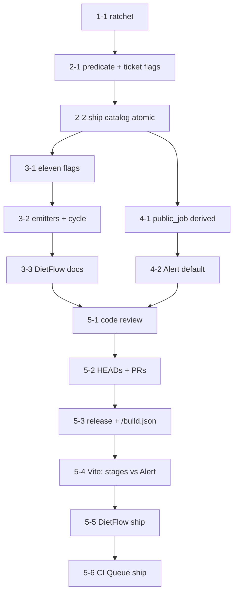

# Implementation Plan: Prova local com progress visível e ship sem Actions

Human-readable summary only. Executable source: `implementation_plan.json`.

The operator needs the test to appear as a job on the installed Vite queue, and merge to happen through ship without GitHub Actions. Recode 11 already chose how. This plan sequences proof so checkout code is not mistaken for the installed product.

## Preconditions

- [x] PRD ready, SPEC Recode 11, R1 review closed
- [x] Route `analyst_prd`, budget `deep`
- [x] DietFlow edits only in `dietflow-ci-queue-node-pin`; never `~/dietflow-app`
- [x] Product tests never write `~/.local/state/local-ci/queue`
- [x] Installed dashboard comes from a verified release, not the git checkout

## Sequence

Review, release activation, and distinct Vite observation happen before any merge. Instrumented tickets must show stages; the Alert is only for undeclared progress. Ships run separately, each with its identity and a frozen HEAD.

## Tasks

| Id | Result | Proof |
| --- | --- | --- |
| 1-1 | Positive ratchet of the current 12; `runtime-probe` off | harness invert |
| 2-1 | Helper without recipe is not smoketest; ticket identity flags must match the recipe | Jest `queue-material-proof.test.ts` |
| 2-2 | Darwin without queue is `LOCAL_RED`; catalog is membership; later commit does not reuse the old HEAD ticket | Jest `ship.test.ts` |
| 3-1 | Eleven goldens declare `progress: true`, argv frozen | Jest instrumentation |
| 3-2 | Ten wrappers emit roots and close running→passed / running→failed | Jest instrumentation |
| 3-3 | Docs invariant copied | grep of the infinitive sentence |
| 4-1 | `public_job.progressEnabled` derived; `flags` hidden | `test_public_job.py` |
| 4-2 | Unconfigured recipe → default Alert, job not failed | vitest presentation |
| 5-1 | Code review + accepted-finding proof | `review_log.json` |
| 5-2 | Specs versioned, trees clean, PRs, frozen HEADs | git status / `gh pr` |
| 5-3 | Verified bundle activated; `/build.json` matches | install.mjs + `/build.json` |
| 5-4 | Instrumented → stages; undeclared → Alert | installed Vite |
| 5-5 | DietFlow `npm run ship` on frozen HEAD | identity dietflowoficial |
| 5-6 | CI Queue `ci-queue ship --no-remote` after 5-5 | identity nmarcofernandess |

## Done Criteria

- Remaining PRD acceptance criteria map to the tasks above.
- Each `tdd.required` task records red+green in `implementation_log.json`.
- Review and `/build.json` precede installed-queue observation.
- Vite occupancy is operational close-out; checkout `npm run check` is not.
